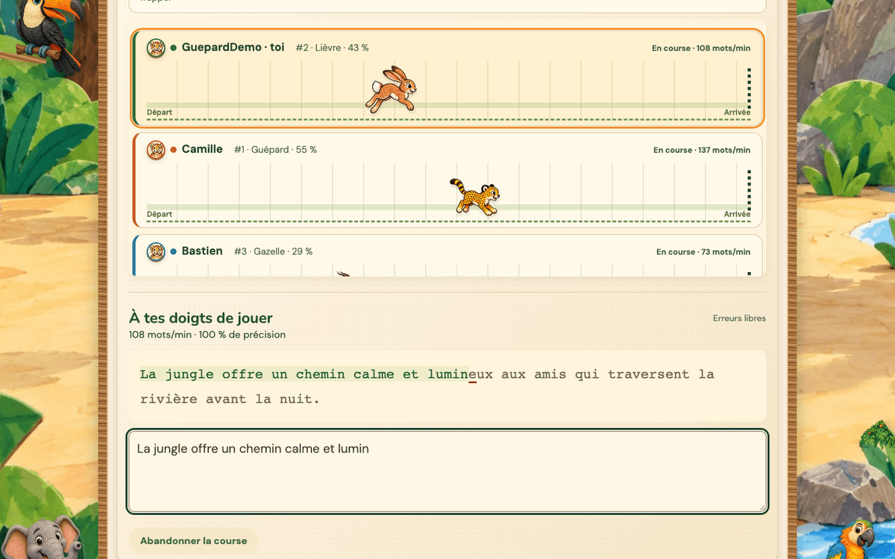

# Guépard

[**Jouer à Guépard**](https://guepard-typing-website-production.up.railway.app)

Guépard est un jeu de course de frappe multijoueur en temps réel, en français et en anglais (FR/EN), avec un thème clair et un thème sombre. On rejoint un salon public, sur code ou privé, on affronte des joueurs et des bots (cinq niveaux), puis on consulte le podium, ses résultats détaillés, ses statistiques et son historique. Les courses accueillent de 2 à 30 participants ; les spectateurs suivent la progression sans taper.

Lecteur visé : enseignant qui corrige le TP, ou développeur qui clone et lance le projet.

## Technologies

Next.js 16 (App Router), React, TypeScript strict, Tailwind CSS 4, PostgreSQL 16, Drizzle ORM et `pg`. Les mises à jour des salons sont diffusées par SSE. Jest et React Testing Library couvrent les composants et la logique ; Playwright couvre les parcours navigateur, les comparaisons visuelles et la charge.

## Installation locale

Prérequis : Node.js 22.18+ ou 24, npm, Docker et Docker Compose.

```sh
npm ci
cp .env.example .env.local
```

Configurer `.env.local` avant de poursuivre (le fichier `.env.example` documente chaque variable). Renseigner `DATABASE_URL`, `AUTH_SECRET`, `APP_URL`, `GUEPARD_DB_PASSWORD` et `GUEPARD_DEMO_PASSWORD`. Pour générer `AUTH_SECRET`, utiliser une chaîne aléatoire d’au moins 32 octets, par exemple `openssl rand -hex 32`. Le mot de passe PostgreSQL de `DATABASE_URL` doit correspondre à `GUEPARD_DB_PASSWORD`. Conserver toutes les valeurs privées hors du dépôt.

```sh
docker compose --env-file .env.local up -d db
npm run db:migrate:sql
npm run db:seed
npm run dev
```

La base est définie dans [compose.yaml](compose.yaml), avec un volume persistant. Attendre son état sain avant les migrations. Le site local est accessible sur [localhost:5173](http://localhost:5173).

Les migrations SQL versionnées sont appliquées par `db:migrate:sql`. Le seed ajoute le corpus, les comptes de démonstration et un historique synthétique. Il conserve les comptes et mots de passe existants : changer `GUEPARD_DEMO_PASSWORD` ne remplace pas un mot de passe déjà enregistré. `npm run db:migrate` sert uniquement à importer les anciens salons JSON et ne remplace pas les migrations SQL.

Pour arrêter PostgreSQL sans supprimer le volume :

```sh
npm run db:stop
```

### Compte de démonstration

Sur le site en ligne (https://guepard-typing-website-production.up.railway.app), un compte de démonstration avec un historique de courses est disponible :

| Nom d'utilisateur | Mot de passe |
|---|---|
| `GuepardDemo` | `JungleDemo2026` |

Ce compte est réservé à la démonstration et à la correction : ce mot de passe n'est utilisé nulle part ailleurs. Il est créé par le seed à partir de `GUEPARD_DEMO_PASSWORD` ; en local, le seed utilise la valeur de cette variable dans `.env.local`. Les courses synthétiques sont identifiées comme des démonstrations.

### Variables d’environnement

[.env.example](.env.example) fournit le modèle ; `.env.local` reste non versionné.

| Variable | Usage |
| --- | --- |
| `DATABASE_URL` | Connexion PostgreSQL du serveur et des scripts |
| `AUTH_SECRET` | Signature des cookies invités et empreintes IP ; requis et stable en production |
| `APP_URL` | Origine canonique du site, contrôle d’origine et callbacks OAuth |
| `GUEPARD_DB_PASSWORD` | Mot de passe PostgreSQL utilisé par Compose |
| `GUEPARD_DEMO_PASSWORD` | Mot de passe choisi pour les comptes du seed ; requis en production |
| `GITHUB_CLIENT_ID`, `GITHUB_CLIENT_SECRET` | Configuration de l’application OAuth GitHub |
| `DISCORD_CLIENT_ID`, `DISCORD_CLIENT_SECRET` | Configuration de l’application OAuth Discord |
| `GUEPARD_CLIENT_IP_HEADER`, `GUEPARD_TRUST_PROXY` | Configuration du proxy de confiance pour identifier les clients |
| `RAILWAY_PUBLIC_DOMAIN`, `PORT`, `NODE_ENV` | Environnement de déploiement et d’exécution |
| `GUEPARD_DATA_DIR` | Stockage JSON de secours, réservé au développement à instance unique |
| `PLAYWRIGHT_CHROME_PATH`, `GUEPARD_TEST_PORT` | Navigateur et port utilisés par les tests |
| `GUEPARD_TEST_DATABASE_URL` | Base dédiée aux tests de concurrence PostgreSQL ; ces tests sont ignorés si elle est absente |
| `LOAD_BASE_URL` | Adresse du serveur isolé utilisé pour le test de charge |

Voir le [guide d’installation](docs/installation/comptes-et-base.md) pour les détails. Les comptes, photos, résultats et contraintes de présence nécessitent PostgreSQL ; le secours JSON ne les remplace pas.

## Connexion GitHub et Discord

La connexion par nom d’utilisateur et mot de passe est disponible. Les deux boutons OAuth nécessitent des applications configurées chez leurs fournisseurs :

| Fournisseur | Variables privées | Callback à enregistrer |
| --- | --- | --- |
| GitHub | `GITHUB_CLIENT_ID`, `GITHUB_CLIENT_SECRET` | `<APP_URL>/api/auth/github/callback` |
| Discord | `DISCORD_CLIENT_ID`, `DISCORD_CLIENT_SECRET` | `<APP_URL>/api/auth/discord/callback` |

Créer des applications distinctes pour le développement et la production, enregistrer les callbacks exacts, puis redémarrer le serveur après configuration. `APP_URL` doit correspondre à l’origine utilisée par le navigateur. Le fonctionnement des fournisseurs réels doit être vérifié séparément : les tests automatisés simulent leurs réponses et utilisent des comptes locaux pour les parcours de bout en bout.

Instructions détaillées : [installation, OAuth et photos](docs/installation/comptes-et-base.md).

## Commandes

| Commande | Description |
| --- | --- |
| `npm run dev` | Serveur de développement local |
| `npm run build` | Compilation de production |
| `npm start` | Démarrage de la compilation de production |
| `npm run lint` | Vérification ESLint |
| `npm run typecheck` | Vérification TypeScript du code et des tests |
| `npm run test` | Tests unitaires et de composants Jest |
| `npm run test:e2e` | Parcours navigateur Playwright, avec une base de test dédiée |
| `GUEPARD_TEST_PORT=5180 npm run test:visual` | Captures et styles calculés sur une compilation de production |
| `npm run test:load` | Course à 30 joueurs, sur un serveur de test déjà démarré |
| `npm run tailwind:metrics` | Mesure de la migration des styles vers Tailwind |

### Tests navigateur et visuels

Préparer une base PostgreSQL dédiée aux tests, appliquer les migrations et exporter `DATABASE_URL` dans le terminal qui lance Playwright. Ne jamais utiliser la base de production : les scénarios créent et suppriment des comptes et des salles. Les variables du fichier `.env.local` ne sont pas automatiquement exportées vers le processus Playwright ; elles doivent être chargées dans son environnement.

```sh
npx playwright install chromium
npm run test:e2e
```

Sur macOS, les configurations utilisent Chrome local s’il est disponible ; `PLAYWRIGHT_CHROME_PATH` permet de choisir l’exécutable.

Les tests visuels démarrent eux-mêmes un serveur de production isolé. Compiler d’abord, libérer le port de test et conserver le port 5180 pour les références de styles :

```sh
npm run build
GUEPARD_TEST_PORT=5180 npm run test:visual
```

Les références de captures et de styles calculés ne sont pas versionnées : elles sont propres à chaque machine (système, polices, rendu). Disposer des références validées pour effectuer une véritable comparaison ; leur création initiale ne prouve pas l’absence de régression. Les limites connues sont consignées dans le [bilan de migration Tailwind](docs/architecture/migration-tailwind.md).

### Charge : course à 30 joueurs

`test:load` ne démarre pas le serveur. Préparer une base dédiée, ses migrations et son seed, compiler puis démarrer un serveur de production isolé avec `DATABASE_URL`, `AUTH_SECRET` et `APP_URL` configurées. Renseigner `LOAD_BASE_URL` pour cibler ce serveur, puis lancer :

```sh
npm run test:load
```

Le scénario utilise 29 clients HTTP/SSE et un navigateur Chromium. Il ne s’exécute ni dans `test:e2e` ni automatiquement dans la CI. Méthode, commandes de démarrage, mesures et limites : [course à 30 joueurs](docs/perf/course-30-joueurs.md).

## Architecture en bref

- `app/` : routes Next.js (App Router), dont les Route Handlers `app/api/` (auth, salons, résultats, avatars).
- `src/components/` : interface React (accueil, salons, course, résultats, statistiques, compte).
- `src/server/` : logique serveur (moteur de course, bots, stockage PostgreSQL, authentification, OAuth).
- `src/styles/` : feuilles de style Tailwind CSS 4 et styles globaux.
- `migrations/` et `scripts/` : migrations SQL versionnées, seed et outils.

Les salons sont stockés en JSONB dans PostgreSQL (table `guepard_rooms`) ; chaque transaction prend un verrou consultatif par salle, et un verrou global seulement pour les opérations qui touchent plusieurs salles. Détails : [architecture](docs/ARCHITECTURE.md).

## Intégration continue

Le workflow GitHub Actions [.github/workflows/ci.yml](.github/workflows/ci.yml) s’exécute à chaque push et pull request, sur Node 22 avec un service PostgreSQL 16. Il lance, dans l’ordre : `npm ci`, `npm run lint`, `npm run typecheck`, `npm test`, `npm run db:migrate:sql`, `npm run db:seed`, `npm run build`, l’installation de Chromium, puis `npm run test:e2e`. Il ne lance ni `test:visual` ni `test:load`.

## Captures d’écran


Captures générées avec Playwright sur la version de production locale (`next build`), avec les données de démonstration du seed et des participants de test.

| Accueil, thème clair | Accueil, thème sombre |
| --- | --- |
|  |  |

| Explorateur de salles | Salon d'attente |
| --- | --- |
|  |  |

| Course en cours | Podium |
| --- | --- |
|  |  |

| Résultats détaillés et graphiques | Profil et statistiques |
| --- | --- |
|  |  |


Vue mobile (360 px de large).


## Documentation et remise

- [Matrice des exigences et limites](docs/EXIGENCES.md)
- [Démarche créative](docs/DEMARCHE-CREATIVE.md) · [version PDF](docs/DEMARCHE-CREATIVE.pdf)
- [Architecture, données et flux temps réel](docs/ARCHITECTURE.md)
- [Migration Tailwind et vérifications visuelles](docs/architecture/migration-tailwind.md)
- [Test de charge et mesures à 30 joueurs](docs/perf/course-30-joueurs.md)
- [Guide de déploiement Railway](docs/deploiement-railway.md)
- [Direction artistique, moodboard et croquis](docs/design/direction-artistique.md)
- [Installation, comptes et OAuth](docs/installation/comptes-et-base.md)
- [Bilan des vérifications locales](docs/verification-fonctionnelle.md)
- [Outils et démarche de travail](docs/IA.md)
- [ADR temps réel](docs/architecture/adr-0001-temps-reel-sse.md) · [ADR bots](docs/architecture/adr-0002-bots.md)

[Site de production](https://guepard-typing-website-production.up.railway.app) · [Dépôt GitHub](https://github.com/marissa274/Guepard-typing-website)

Le partage du dépôt avec l’enseignant, les accès de démonstration et les vérifications sur le site public doivent accompagner la remise. Les résultats locaux ne certifient pas la disponibilité du déploiement, les callbacks OAuth réels ni une exécution distante de la CI. `CHECKPOINT-1.md` conserve uniquement l’état historique du premier checkpoint.
