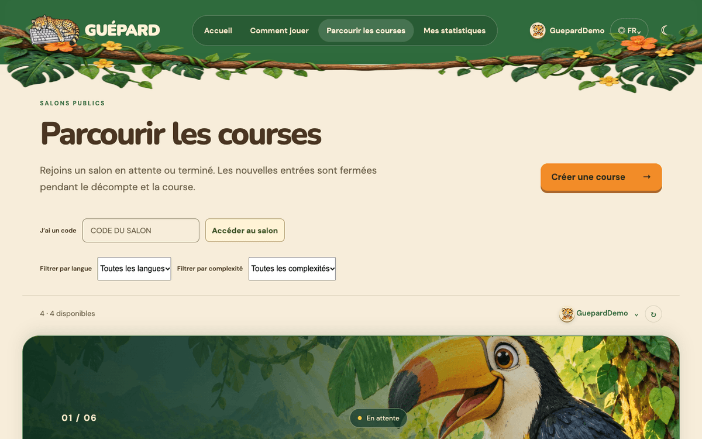
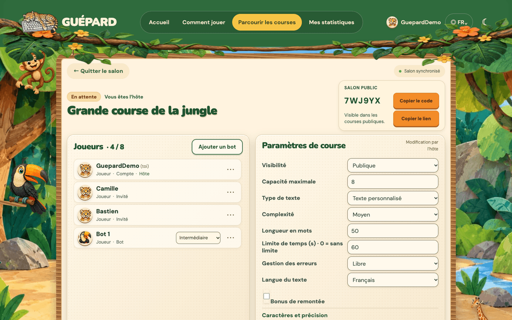
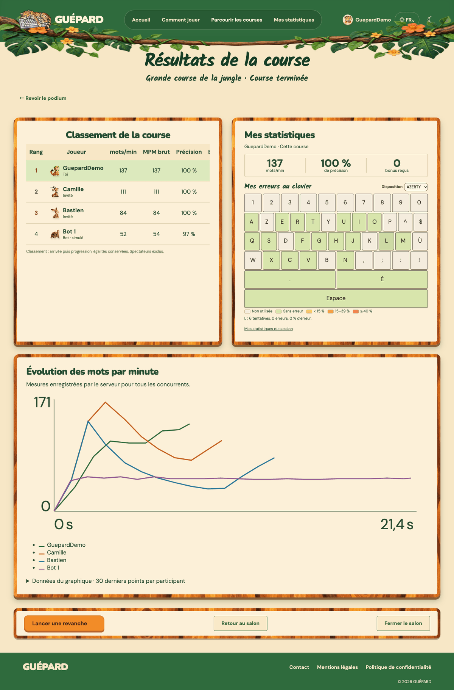

# Guépard

Jeu de course de frappe multijoueur en temps réel, en français et en anglais : salons publics, sur code ou privés, bots de cinq niveaux, bonus de remontée, résultats et historique par compte.

Lecteur visé : enseignant, correcteur ou développeur qui installe et évalue le projet.

## Captures d'écran

Captures générées avec Playwright sur la version de production locale (`next build`), avec les données de démonstration du seed et des participants de test.

| Accueil, thème clair | Accueil, thème sombre |
| --- | --- |
|  |  |

| Explorateur de salles | Salon d'attente |
| --- | --- |
|  |  |

| Course en cours | Podium |
| --- | --- |
|  |  |

| Résultats détaillés et graphiques | Profil et statistiques |
| --- | --- |
|  |  |


Vue mobile (360 px de large).

## URL de production

À confirmer par l'autrice. `LIENS-REMISE.txt` mentionne `https://guepard-typing-website-production.up.railway.app/` pour le checkpoint 1 ; cette adresse n'a pas été revérifiée pour la remise finale.

## Technologies

Versions déclarées dans `package.json` (plages semver) :

| Domaine | Technologie |
| --- | --- |
| Framework | Next.js 16.4.6 (App Router, Route Handlers Node.js), build avec webpack |
| Interface | React ^19.3.0, TypeScript ^5.9.3 (strict), Tailwind CSS ^4.3.3 et CSS |
| Base de données | PostgreSQL 16 (image `postgres:16-alpine`), `pg` ^8.23.1, Drizzle ORM ^0.45.4 |
| Images | sharp 0.35.5 (traitement des photos de profil) |
| Tests | Jest ^30.5.2, React Testing Library ^16.3.3, Playwright ^1.63.0 |
| Qualité | ESLint ^10.14.0, typescript-eslint ^8.72.2 |
| Exécution | Node.js 22.18+ ou 24 (la CI utilise Node 22) ; Docker pour la base locale |
| Mots de passe | scrypt (module `node:crypto`) |

## Démarrage local

Prérequis : Node.js 22.18+ (ou 24), npm, Docker pour PostgreSQL.

```sh
npm ci
cp .env.example .env.local
npm run db:up
npm run db:migrate:sql
npm run db:seed
npm run dev
```

Ouvrir http://localhost:5173. Vérifier les variables de `.env.local` avant de lancer les commandes : `DATABASE_URL`, `AUTH_SECRET` et `APP_URL` sont expliquées dans [le guide d’installation](docs/installation/comptes-et-base.md). Le mot de passe Compose doit correspondre à celui de `DATABASE_URL`. Si un volume PostgreSQL existe déjà, changer une variable ne change pas son mot de passe enregistré.

Le seed idempotent ajoute 12 corpus FR/EN et le compte de démonstration **GuepardDemo**, avec trois courses synthétiques clairement nommées. En développement, son mot de passe public est **GuepardDemo2026!**. Ne jamais réutiliser un mot de passe personnel pour ce compte de correction.

**Piège en production (`GUEPARD_DEMO_PASSWORD`).** `scripts/db-seed.ts` utilise le mot de passe public par défaut dès que `NODE_ENV` n'est pas `production`, et ne crée le compte que s'il n'existe pas (`ON CONFLICT DO NOTHING`) : modifier la variable ensuite ne change pas un mot de passe déjà enregistré. Lancer le seed contre la base de production sans `NODE_ENV=production`, ou avant d'avoir défini la variable, laisse donc un compte public connu. Définir la variable (8 à 128 caractères) avant le premier seed, ou supprimer le compte et relancer. Le mot de passe de production à communiquer au correcteur est celui que vous avez choisi : il n'est pas dans le dépôt.

## Variables d'environnement

Modèle : `.env.example` (copié dans `.env.local`, non versionné). Variables lues par le code :

| Variable | Rôle | Obligatoire |
| --- | --- | --- |
| `DATABASE_URL` | connexion PostgreSQL ; sans elle, les salons utilisent le secours JSON local à instance unique | oui (hors secours local) |
| `AUTH_SECRET` | secret stable pour signer l'identité invitée | oui en production |
| `APP_URL` | URL publique canonique, sans chemin ; contrôle d'origine et OAuth | oui en production pour OAuth |
| `RAILWAY_PUBLIC_DOMAIN` | fournie par Railway, utilisée si `APP_URL` est absente | non |
| `GITHUB_CLIENT_ID`, `GITHUB_CLIENT_SECRET` | application OAuth GitHub | non |
| `DISCORD_CLIENT_ID`, `DISCORD_CLIENT_SECRET` | application OAuth Discord | non |
| `GUEPARD_DEMO_PASSWORD` | mot de passe du compte de démonstration pour `db:seed` | oui si `NODE_ENV=production` |
| `GUEPARD_DB_PASSWORD` | mot de passe PostgreSQL de Docker Compose (défaut `guepard_dev_only`), à faire correspondre à `DATABASE_URL` | non |
| `GUEPARD_DATA_DIR` | dossier du secours JSON et du secret invité local (défaut `.data`) | non |
| `GUEPARD_CLIENT_IP_HEADER`, `GUEPARD_TRUST_PROXY` | source de l'IP client : en-tête écrasé par la plateforme (`X-Real-IP` sur Railway) ou nombre de proxys qui complètent `X-Forwarded-For` ; sans eux, une empreinte partagée (voir `docs/deploiement-railway.md`) | oui en production |
| `PLAYWRIGHT_CHROME_PATH`, `GUEPARD_TEST_PORT` | tests navigateur : exécutable Chrome et port du serveur isolé | non |
| `NODE_ENV`, `PORT` | gérées par Next.js / l'hébergeur (`PORT` utilisé par `npm start`) | non |

`npm run db:migrate` importe les anciens salons JSON ; cette commande est distincte des migrations SQL versionnées. `npm run db:stop` arrête la base sans supprimer son volume.

## Fonctionnalités

- Comptes par mot de passe, sessions PostgreSQL, profil, changement de mot de passe et photo JPEG/PNG/WebP recadrée côté serveur. Flux OAuth GitHub/Discord préparés ; leur activation exige vos applications et variables privées.
- Salons publics, sur code ou privés ; capacité de 2 à 30 joueurs, spectateurs, invitations révocables, présence unique et transfert de l’hôte. Les invités utilisent une identité signée et ne créent pas de salon.
- Corpus en base, trois complexités, textes FR/EN cohérents ou aléatoires, paramètres de caractères, durée et correction. Les options d’inclusion/exclusion concernent les mots aléatoires.
- Décompte serveur de trois secondes, progression contrôlée, cinq niveaux de bots déterministes, abandon et reconnexion, bonus de remontée facultatifs. Une course commencée refuse les nouvelles entrées.
- Résultats avec MPM net/brut, précision, erreurs, bonus, courbes temporelles réellement collectées et heatmap personnelle. Historique PostgreSQL paginé, consultation après fermeture du salon et annonce de record personnel. Les invités gardent des statistiques de session.
- Interface FR/EN, préférence de langue conservée en cookie, thème initial selon le système. Sur petit écran, la course recommande un clavier physique ; les résultats restent accessibles.

Les principaux chemins sont `/`, `/login`, `/signup`, `/play`, `/create`, `/races`, `/lobby/:id`, `/how`, `/stats` et `/history/:id`. `/demo/podium` est une démonstration explicitement fictive. Les anciens parcours locaux `/race/:id` sont conservés pour compatibilité ; les courses partagées passent par `/lobby/:id`.

## Vérifications

```sh
npm run lint
npm run typecheck
npm test
npm run build
npx playwright install chromium
npm run test:e2e
```

Playwright emploie Chrome local sur macOS s’il est disponible, sinon Chromium Playwright ; `PLAYWRIGHT_CHROME_PATH` permet de choisir l’exécutable. Préparer la base avant les tests. Pour tester la compilation de production sur un port distinct, fournir `GUEPARD_TEST_PORT=5191`, `DATABASE_URL` et `AUTH_SECRET` à la commande Playwright. Les scénarios créent leurs propres comptes et salons.

La CI versionnée prépare PostgreSQL, installe avec `npm ci`, lance lint, typage strict, tests, migrations, seed, build et parcours navigateur. Son exécution distante et le déploiement HTTPS doivent être vérifiés sur les services réels.

## Documentation

- [Architecture et sécurité](docs/ARCHITECTURE.md)
- [Installation, OAuth et photos](docs/installation/comptes-et-base.md)
- [Exigences et limites de remise](docs/EXIGENCES.md)
- [Utilisation des agents IA](docs/IA.md)
- [Bots et choix de simulation](docs/fonctionnalites/bots.md), [ADR bots](docs/architecture/adr-0002-bots.md)
- [Textes, complexité et bonus](docs/fonctionnalites/textes-et-bonus.md)
- [Guide de déploiement Railway](docs/deploiement-railway.md)

`CHECKPOINT-1.md` décrit l'état historique du checkpoint 1 et ne constitue pas le bilan de la remise finale. Restent à fournir par l'autrice : `docs/DEMARCHE-CREATIVE.md` (nom, logo, direction artistique), l'URL de production confirmée et les coordonnées légales.
