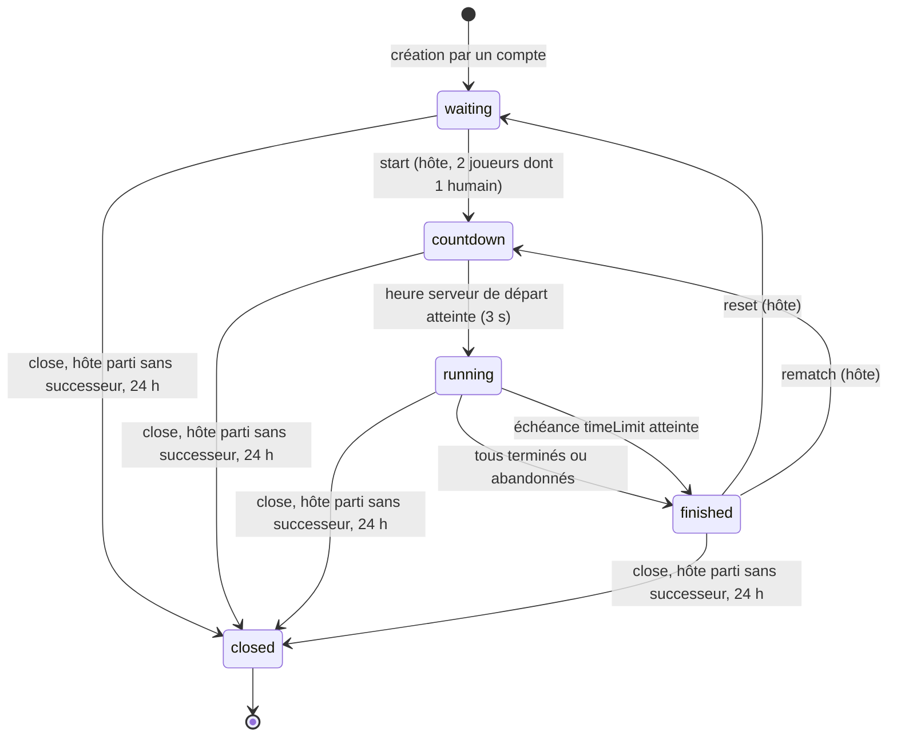

# Architecture de Guépard

## Application et stockage

L’application utilise Next.js App Router, React, TypeScript strict et Tailwind/CSS. Les Route Handlers s’exécutent dans Node.js. PostgreSQL conserve les comptes, sessions, photos, états OAuth, salons JSONB, présences, tentatives de code, corpus et résultats. Drizzle fournit le modèle et la lecture typée du corpus ; les transactions de salon utilisent directement `pg` pour leurs verrous et contraintes explicites.

Les migrations SQL versionnées sont dans `migrations/`. `npm run db:migrate:sql` les applique sous verrou, avec une somme SHA-256 et une transaction par fichier. `npm run db:seed` ajoute le corpus original, un compte de démonstration et trois historiques clairement synthétiques, sans remplacer les données existantes. Les scripts lisent `.env.local` s’il existe et acceptent les variables du serveur/CI.

Lecteur visé : développeur ou enseignant qui relit l'architecture. Les définitions exécutables sont dans `migrations/001_core.sql`, `002_oauth_avatars.sql` et `003_room_memberships.sql`.

```mermaid
erDiagram
  guepard_users ||--o{ guepard_sessions : "user_id (CASCADE)"
  guepard_users ||--o| guepard_avatars : "user_id (CASCADE)"
  guepard_users ||--o{ guepard_oauth_accounts : "user_id (CASCADE)"
  guepard_users ||--o{ guepard_results : "user_id (logique, sans FK)"
  guepard_rooms ||--o{ guepard_room_memberships : "room_id (CASCADE)"
  guepard_users {
    uuid id PK
    text username
    text username_key UK
    text password_hash "nullable (compte OAuth)"
    text avatar
    timestamptz created_at
  }
  guepard_sessions {
    text token_hash PK
    uuid user_id FK
    timestamptz expires_at
  }
  guepard_avatars {
    uuid user_id PK, FK
    bytea data "max 2 Mio"
    uuid version
    timestamptz updated_at
  }
  guepard_oauth_accounts {
    text provider PK "github ou discord"
    text provider_id PK
    uuid user_id FK "UNIQUE(provider, user_id)"
  }
  guepard_oauth_states {
    text state_hash PK
    text provider "github ou discord"
    text verifier
    text redirect_uri
    timestamptz expires_at
  }
  guepard_rooms {
    text id PK
    jsonb data "index unique sur data->>code"
  }
  guepard_room_memberships {
    text identity_key PK
    text room_id FK
    text person_id "UNIQUE(room_id, person_id)"
  }
  guepard_code_attempts {
    text ip_hash PK
    bigint window_started
    integer attempts "CHECK >= 0"
  }
  guepard_results {
    text id PK
    uuid user_id "UNIQUE(user_id, room_id, started_at)"
    text room_id
    bigint started_at
    bigint ended_at
    jsonb result
    jsonb snapshot
  }
  guepard_corpus {
    text id PK
    text language "FR ou EN"
    text complexity "easy, medium, hard"
    text kind "story ou words"
    text content
    text source
  }
  guepard_migrations {
    text name PK
    text checksum
    timestamptz applied_at
  }
```



Rôle des tables sans clé étrangère : `guepard_oauth_states` conserve l'état, le vérificateur PKCE et l'URI de retour d'une connexion OAuth en cours (avec son échéance) ; `guepard_code_attempts` compte les tentatives de code de salon par empreinte IP (fenêtre de 60 s, refus au-delà de 10 tentatives, code `CODE_RATE_LIMITED`) ; `guepard_corpus` contient les textes ; `guepard_migrations` (créée par `scripts/db-migrate.ts`) mémorise le nom, la somme SHA-256 et la date de chaque migration appliquée. Les tables `guepard_rooms` et `guepard_code_attempts` sont aussi créées à la demande par le code serveur (`CREATE TABLE IF NOT EXISTS`).

`guepard_results.user_id` est une association logique au compte (pas de clé étrangère dans la migration) ; les autres clés étrangères sont celles du diagramme. La contrainte `(user_id, room_id, started_at)` empêche de sauvegarder deux fois la même manche. Un index unique sur le code JSONB et la clé primaire de `guepard_room_memberships.identity_key` garantissent l’unicité en base. Les modifications de salon et de présence sont sérialisées dans une transaction PostgreSQL.

## Identités, permissions et invitations

Un compte utilise un cookie HttpOnly et un jeton dont seul le hash est en base. Un invité dispose d’un cookie HMAC signé, avec pseudo de 3 à 20 caractères. Les invités rejoignent les salons mais ne les créent pas. À la connexion d’un invité, sa présence est rattachée au compte ; si celui-ci est déjà ailleurs, la présence invitée est quittée. La déconnexion quitte la présence du compte.

Les jetons de membre sont des capacités privées, distinctes du cookie de compte. Les vues partagées retirent jetons, identifiants de compte, clés de présence, empreintes IP et budgets de frappe. Une saisie et sa heatmap ne sont envoyées qu’à leur propriétaire. L’historique applique toujours un filtre par compte authentifié.

Les invitations contiennent 256 bits aléatoires. La première utilisation les lie à l’identité signée et à l’empreinte IP ; leur destinataire peut les rejouer avec ces deux propriétés. Une expulsion révoque ses invitations et bannit son identité du salon ; l’empreinte IP de l’expulsé refuse en plus les nouvelles identités invitées pendant 10 minutes, sans jamais refuser les membres déjà présents ni les comptes, pour préserver les autres élèves derrière le même NAT. Les en-têtes IP ne sont utilisés que derrière un proxy explicitement déclaré (`GUEPARD_CLIENT_IP_HEADER` ou `GUEPARD_TRUST_PROXY`) ; IPv6 est regroupé par /64. Les limites de tentatives de code sont persistées par empreinte IP dans PostgreSQL.

## Machine à états

Correspondance entre les noms de l'énoncé (COURSE-01) et la valeur stockée dans `Room.phase` (`src/lib/room-types.ts`) :

| État de l'énoncé | Valeur dans le code | Entrée dans l'état |
| --- | --- | --- |
| EN_ATTENTE | `waiting` | création du salon ; `reset` depuis les résultats |
| DÉCOMPTE | `countdown` | action `start` ou `rematch` de l'hôte ; `startedAt = maintenant + 3 s` |
| EN_COURSE | `running` | `tick` constate `maintenant >= startedAt` |
| RÉSULTATS | `finished` | tous les joueurs ont terminé ou abandonné, ou échéance atteinte |
| FERMÉE | aucune valeur : la ligne `guepard_rooms` est supprimée | `close`, départ de l'hôte sans successeur, ou salon de plus de 24 h |



Ces transitions sont les mêmes que dans [machine-etats.md](architecture/machine-etats.md) et correspondent à `src/server/room-engine.ts` (`act`, `tick`) et `src/server/room-service.ts` (`leave`, `mutate`). `reset` et `rematch` exigent la phase `finished` : il n'existe pas de retour direct de `countdown` ou `running` vers `waiting` (le code répond « La course doit être terminée. »). `rematch` enchaîne `reset` puis `start` en un seul appel. Les réglages, l'ajout de bots, les rôles et le lancement exigent la phase `waiting`.

Le passage `countdown` → `running` et la fin de course sont évalués paresseusement : ils sont constatés par `tick`, appelé à chaque lecture ou action sur le salon (donc à chaque envoi SSE). Quitter comme hôte transfère ce rôle au plus ancien compte authentifié encore présent (participant ou spectateur, vu depuis moins de 35 s) ; s'il n'y en a aucun, le salon est supprimé. Fermer est une action distincte réservée à l'hôte. Les entrées nouvelles sont admises en attente ou aux résultats, jamais pendant le décompte ou la course. Une même identité peut restaurer sa présence sans doublon dans un second onglet.

## Flux temps réel et autorité

Décision et historique : [ADR-0001](architecture/adr-0001-temps-reel-sse.md). Le navigateur envoie ses actions par POST JSON ; le serveur diffuse l'état complet du salon par SSE. Le jeton de membre est transmis dans l'en-tête `Authorization: Bearer`, ce qui explique que le client lise le flux avec `fetch` et non avec `EventSource` (`src/lib/room-client.ts`).

```mermaid
sequenceDiagram
  autonumber
  participant H as Navigateur hôte
  participant B as Navigateur joueur
  participant S as Route Handlers (Node.js)
  participant DB as PostgreSQL

  H->>S: POST /api/rooms {action:create,...}
  S->>DB: transaction (verrou consultatif) : insère le salon
  S-->>H: {room, token}
  B->>S: POST /api/rooms/:id {action:join, nickname, code|invite}
  S-->>B: {room, token}
  H->>S: GET /api/rooms/:id/events (Bearer)
  B->>S: GET /api/rooms/:id/events (Bearer)
  loop toutes les ~600 ms et par abonné
    S->>DB: lit le salon (tick, présence)
    alt révision modifiée
      S-->>H: data: {"room": vue}
      S-->>B: data: {"room": vue}
    else inchangée
      S-->>B: : heartbeat
    end
  end
  H->>S: POST {action:start}
  S->>DB: génère le texte, phase countdown, startedAt = maintenant + 3 s
  S-->>H: {room}
  Note over S: tick : countdown devient running à startedAt
  loop toutes les 180 ms, une requête à la fois
    B->>S: POST {action:progress, value, typed, heatmap}
    S->>S: valide saisie, budget de frappe, heatmap ; bonus ; télémétrie
    S->>DB: enregistre le salon modifié
  end
  Note over S: tick : bots rejoués sur la grille de 250 ms depuis leur graine
  S->>DB: fin de course : persiste les résultats des humains connectés
  S-->>B: data: {"room": vue, phase: finished}
  H->>S: POST {action:close}
  S-->>B: data: {"closed":true}
```

### Événements SSE

Le flux est `text/event-stream` sans champs `event:` ni `id:`. Trois types de messages (`app/api/rooms/[id]/events/route.ts`) :

| Message | Contenu | Quand |
| --- | --- | --- |
| `data: {"room": RoomView}` | vue complète du salon propre à l'abonné (sa saisie et sa heatmap, jamais celles des autres ; les invitations seulement pour l'hôte) | à l'ouverture, puis chaque fois que `revision` diffère de la dernière valeur envoyée |
| `: heartbeat` | commentaire SSE | à chaque lecture sans changement de révision |
| `data: {"closed":true}` | fin du salon, puis fermeture du flux | la lecture échoue (salon supprimé, jeton ne correspondant plus) |

Avant d'ouvrir le flux, une lecture d'essai renvoie une erreur HTTP JSON en cas de jeton ou de salon invalide ; le client traite 403 et 404 comme une fermeture. Si le flux s'interrompt, le client attend 1,5 s et se reconnecte ; il ignore toute vue dont la révision est inférieure à la dernière reçue.

### Requêtes d'action (POST)

Toutes les requêtes passent par `body()` : origine contrôlée, corps JSON limité à 64 Kio. `POST /api/rooms` n'exige pas de jeton de membre ; `POST /api/rooms/:id` exige `Authorization: Bearer <jeton de membre>` sauf pour `join`.

| Route | `action` | Charge utile | Réservé à |
| --- | --- | --- | --- |
| `GET /api/rooms` | (liste) | paramètres `language`, `complexity` | tous ; salons publics seulement |
| `POST /api/rooms` | `create` (défaut) | `name`, `animal`, `visibility`, `language`, `capacity`, `role` | compte authentifié |
| `POST /api/rooms` | `quick` | `nickname` | compte ou invité |
| `POST /api/rooms` | `resolve` | `code` (6 caractères, limité par IP) | compte ou invité |
| `POST /api/rooms` | `leave-current` | aucune | compte ou invité |
| `POST /api/rooms/:id` | `join` | `nickname`, `role`, `code` ou `invite` | compte ou invité |
| | `heartbeat` | aucune (envoyé toutes les 15 s) | membre |
| | `progress` | `value` (saisie complète), `typed` (frappes cumulées), `heatmap` (touches : `{hits, errors}`) | joueur en course |
| | `abandon` | aucune | joueur en course |
| | `leave` | aucune | membre |
| | `close` | aucune | hôte |
| | `invite` | `count` (1 à 30) | hôte, salon non public |
| | `revokeInvite` | `invite` (jeton) | hôte |
| | `kick` | `personId` | hôte |
| | `settings` | `settings` (objet partiel de réglages) | hôte, phase `waiting` |
| | `bot` | `difficulty` facultatif (défaut `medium`) | hôte, phase `waiting` |
| | `difficulty` | `personId`, `difficulty` | hôte, phase `waiting` |
| | `role` | `personId`, `role` (`player` ou `spectator`) | hôte, phase `waiting` |
| | `start` | aucune | hôte, phase `waiting` |
| | `reset` | aucune | hôte, phase `finished` |
| | `rematch` | aucune | hôte, phase `finished` |

Les réponses d'action contiennent en général `{room}` (vue de l'appelant) ; `join`, `create` et `quick` ajoutent `token` ; `invite` ajoute `invitation` et `invitations` ; `leave` et `close` renvoient `left` (et `closed`).

### Cadences réelles

| Élément | Valeur | Source |
| --- | --- | --- |
| Envoi des frappes par le client | une requête `progress` à la fois, au plus toutes les 180 ms, avec la dernière saisie seulement (environ 5 par seconde au plus, sous le plafond de 10 par seconde de PERF-02) | `VisualRace.tsx` |
| Lecture SSE côté serveur | 600 ms après la fin de la lecture précédente, par abonné | `events/route.ts` |
| Grille des bots, bonus et MPM | 250 ms depuis `startedAt` | `room-engine.ts` (`tick`) |
| Échantillons MPM | au plus un par seconde en rattrapage de grille, plus un échantillon forcé à chaque `progress` ou abandon | `race-telemetry.ts` |
| Battement de présence | POST `heartbeat` toutes les 15 s ; `seen` aussi rafraîchi par une lecture si plus de 5 s | `Lobby.tsx`, `room-service.ts` |
| Reconnexion SSE | 1,5 s | `Lobby.tsx` |
| Abandon sur absence | 30 s sans présence en course | `room-engine.ts` |

Le serveur reste autoritaire : il valide chaque saisie (préfixe correct en mode correction obligatoire, compteur de frappes, budget de 25 caractères/s avec 8 initiaux et 40 au plus, agrégat clavier cohérent) avant de modifier la progression, applique bonus et bots, et fixe les heures de départ, de fin et d'abandon. Une présence observée par SSE ou battement conserve le joueur ; une absence de plus de 30 secondes en course l'abandonne à cette échéance, sans résurrection lors d'un retour tardif. Ce budget est une validation de plausibilité, pas une certification d'absence de toute triche côté client.

Chaque transaction relit toutes les lignes de `guepard_rooms` sous un verrou consultatif global et n'écrit que les salons dont le JSON a changé. Il n'y a donc pas d'écriture par frappe, mais une écriture du salon par requête `progress` acceptée et par lecture qui fait avancer `tick` pendant la course. La fin de course et les résultats des humains connectés sont persistés dans la même transaction. Le snapshot nettoyé conserve les séries de tous les concurrents et la heatmap du propriétaire ; l'historique reste consultable après fermeture du salon.

## Gestion des bots

Résumé de la décision (détails, alternatives et conséquences : [ADR-0002](architecture/adr-0002-bots.md) et [bots.md](fonctionnalites/bots.md)). Les bots sont des participants `kind: 'bot'` sans jeton, simulés côté serveur par `src/server/bot-engine.ts`. Leur état est une fonction pure de `(graine, niveau, texte, mode d'erreur, temps écoulé)`, avec la graine `identifiant du salon : identifiant du bot : heure de départ`. Le serveur les avance sur la grille de 250 ms ; le résultat ne dépend donc pas de la cadence des lectures.

## Textes, bonus et calculs

Le corpus PostgreSQL comporte FR/EN, phrases/mots et trois complexités. La langue du texte est indépendante de l'interface. Les critères mesurables de complexité (CONF-05), le comportement des inclusions/exclusions en mode cohérent (CONF-07) et la règle exacte des bonus (BONUS-01, BONUS-02) sont dans [textes-et-bonus.md](fonctionnalites/textes-et-bonus.md). Chaque joueur a son texte cible ; le classement compare les progressions normalisées (progression divisée par la longueur de son propre texte) et conserve les temps d'arrivée.

MPM net = caractères validés / 5 / minutes. MPM brut = frappes totales / 5 / minutes. Précision = (frappes totales − erreurs observées) / frappes totales. Une suppression de lettre correcte ne devient pas une erreur. Les mesures d'un abandon sont figées à `abandonedAt`.

## Limites de déploiement et sources

Le fallback JSON est réservé à une instance locale sans PostgreSQL ; il ne remplace pas les contraintes SQL de production. OAuth exige les applications GitHub/Discord et leurs secrets, ainsi qu’une URL HTTPS canonique. Leur configuration réelle reste à effectuer par le propriétaire. La validation locale ne prouve pas une disponibilité publique ni une exécution distante de GitHub Actions.

Détails : [comptes et base](installation/comptes-et-base.md), [matrice des exigences](EXIGENCES.md), [ADR SSE](architecture/adr-0001-temps-reel-sse.md), [ADR bots](architecture/adr-0002-bots.md), [bots](fonctionnalites/bots.md), [textes et bonus](fonctionnalites/textes-et-bonus.md).
