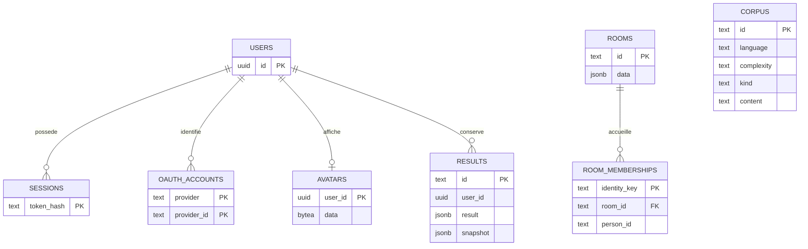
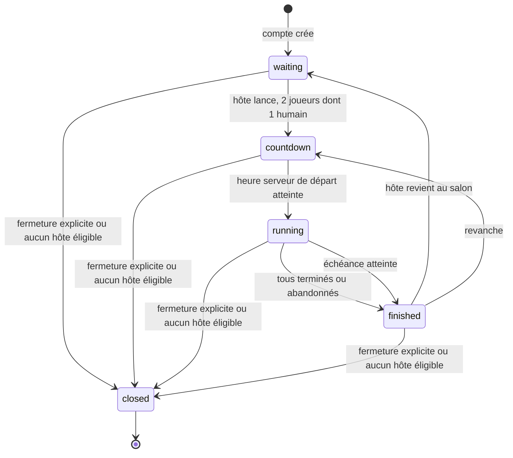

# Architecture de Guépard

## Application et stockage

L’application utilise Next.js App Router, React, TypeScript strict et Tailwind/CSS. Les Route Handlers s’exécutent dans Node.js. PostgreSQL conserve les comptes, sessions, photos, états OAuth, salons JSONB, présences, tentatives de code, corpus et résultats. Drizzle fournit le modèle et la lecture typée du corpus ; les transactions de salon utilisent directement `pg` pour leurs verrous et contraintes explicites.

Les migrations SQL versionnées sont dans `migrations/`. `npm run db:migrate:sql` les applique sous verrou, avec une somme SHA-256 et une transaction par fichier. `npm run db:seed` ajoute le corpus original, un compte de démonstration et trois historiques clairement synthétiques, sans remplacer les données existantes. Les scripts lisent `.env.local` s’il existe et acceptent les variables du serveur/CI.

`guepard_results.user_id` est une association logique au compte ; les autres clés étrangères sont définies dans les migrations. La contrainte `(user_id, room_id, started_at)` empêche de sauvegarder deux fois la même manche. Un index unique sur le code JSONB et la clé primaire de `guepard_room_memberships.identity_key` garantissent l’unicité en base. Les modifications de salon et de présence sont sérialisées dans une transaction PostgreSQL.

## Identités, permissions et invitations

Un compte utilise un cookie HttpOnly et un jeton dont seul le hash est en base. Un invité dispose d’un cookie HMAC signé, avec pseudo de 3 à 20 caractères. Les invités rejoignent les salons mais ne les créent pas. À la connexion d’un invité, sa présence est rattachée au compte ; si celui-ci est déjà ailleurs, la présence invitée est quittée. La déconnexion quitte la présence du compte.

Les jetons de membre sont des capacités privées, distinctes du cookie de compte. Les vues partagées retirent jetons, identifiants de compte, clés de présence, empreintes IP et budgets de frappe. Une saisie et sa heatmap ne sont envoyées qu’à leur propriétaire. L’historique applique toujours un filtre par compte authentifié.

Les invitations contiennent 256 bits aléatoires. La première utilisation les lie à l’identité signée et à l’empreinte IP ; leur destinataire peut les rejouer avec ces deux propriétés. Une expulsion révoque ses invitations et bannit son identité du salon. L’IP n’est pas bannie globalement pour préserver les autres élèves derrière le même NAT. Les en-têtes IP ne sont utilisés que derrière un proxy explicitement déclaré fiable. Les limites de tentatives de code sont persistées par empreinte IP dans PostgreSQL.

## Machine à états

`closed` est conceptuel : la ligne de salon est supprimée. Quitter comme hôte transfère ce rôle au plus ancien humain authentifié encore présent ; fermer est une action distincte. Les entrées nouvelles sont admises en attente ou aux résultats, jamais pendant le décompte ou la course. Une même identité peut restaurer sa présence sans doublon dans un second onglet.

## Flux temps réel et autorité

1. Le navigateur rejoint/crée via l’API et conserve son jeton de membre dans `sessionStorage`.
2. Il ouvre un flux SSE authentifié par ce jeton. Une révision plus récente remplace la vue locale ; les reconnexions sont automatiques.
3. Les frappes sont regroupées sur environ 180 ms. Le serveur valide saisie, compteurs, budget temporel et agrégat clavier avant de modifier la progression.
4. Le serveur avance les événements des bots sur une grille temporelle de 250 ms, applique les points de contrôle des bonus, puis échantillonne les séries MPM. Les heures de départ, de fin et d’abandon viennent du serveur.
5. La fin et les résultats des humains connectés sont persistés dans la même transaction. Le snapshot nettoyé conserve les séries de tous les concurrents et la heatmap du propriétaire. L’historique reste consultable après fermeture du salon.

Une présence observée par SSE/heartbeat conserve le joueur. Une absence de plus de 30 secondes en course l’abandonne à cette échéance, sans résurrection lors d’un retour tardif. Le budget de frappe permet 25 caractères/s, 8 caractères initiaux et une réserve réseau de 40 caractères au maximum. Il constitue une validation de plausibilité, pas une certification d’absence de toute triche côté client.

## Textes, bonus et calculs

Le corpus PostgreSQL comporte FR/EN, phrases/mots et trois complexités. La langue du texte est indépendante de l’interface. Les inclusions/exclusions s’appliquent aux mots aléatoires ; elles sont désactivées pour les passages et textes personnalisés. Une inclusion explicite est prioritaire sur les catégories de caractères, mais ne peut pas contredire une exclusion. Les choix et sources sont dans `src/data/corpus.ts` et `src/server/text-generator.ts`.

Les bonus sont optionnels. Aux checkpoints 25 %, 50 % et 75 %, le dernier ou un joueur à plus de 25 points de progression derrière le meneur peut recevoir un bonus, au plus trois par manche. Le raccourci retire jusqu’à trois mots non encore saisis, le détour ajoute des mots au meneur et la pause l’arrête deux secondes. Chaque joueur a son texte cible ; le classement compare les progressions normalisées et conserve les temps d’arrivée.

MPM net = caractères validés / 5 / minutes. MPM brut = frappes totales / 5 / minutes. Précision = (frappes totales − erreurs observées) / frappes totales. Une suppression de lettre correcte ne devient pas une erreur. Les mesures d’un abandon sont figées à `abandonedAt`. Les bots utilisent une graine salon/joueur/départ : leur parcours est reproductible, avec variations, hésitations et temps de correction.

## Limites de déploiement et sources

Le fallback JSON est réservé à une instance locale sans PostgreSQL ; il ne remplace pas les contraintes SQL de production. OAuth exige les applications GitHub/Discord et leurs secrets, ainsi qu’une URL HTTPS canonique. Leur configuration réelle reste à effectuer par le propriétaire. La validation locale ne prouve pas une disponibilité publique ni une exécution distante de GitHub Actions.

Détails : [comptes et base](installation/comptes-et-base.md), [matrice des exigences](EXIGENCES.md), [ADR SSE](architecture/adr-0001-temps-reel-sse.md), [bots](fonctionnalites/bots.md).
