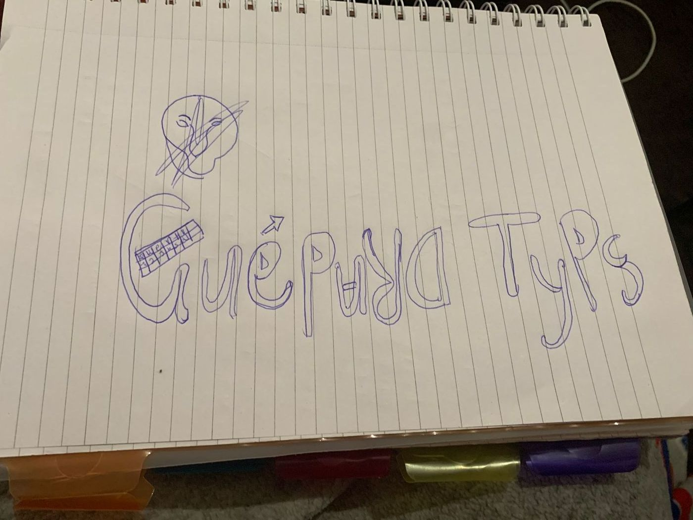
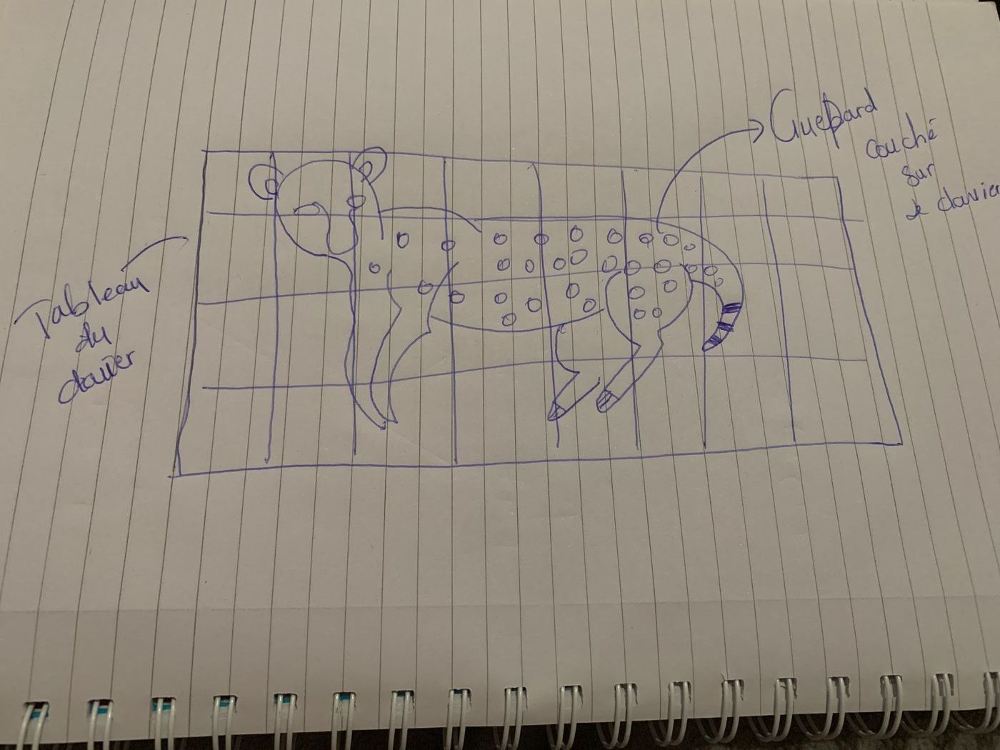
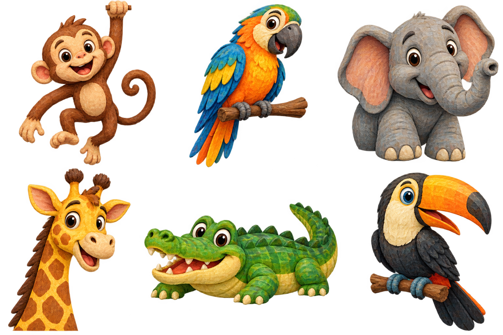

# Démarche créative : nom et logo

La première exploration documentée est datée du **29 septembre 2026** dans l’export de la conversation sur le concept de clavier. Le brief du **1er octobre 2026** présente le nom et le logo Guépard. Le **20 novembre 2026** est la date de documentation et de vérification du nom.

Ce document retrace les choix du nom et du logo pour les exigences DES-01 et DES-02 de la [matrice d’exigences](EXIGENCES.md).

## 1. Les premières pistes : main, clavier et jeu pour enfants

Mon premier concept est un dessin noir et blanc d’une main avec un clavier dans la paume. Je précise que l’index et le majeur forment un signe de paix et se posent sur les touches Q et R. L’idée est de représenter une application de vitesse de frappe. ChatGPT en produit des propositions visuelles à partir de ma description, que je corrige pour obtenir une seule main plutôt que deux.

Je cherche ensuite des références de sites pour enfants, ludiques, animés et très visuels. ChatGPT propose notamment My Little Storybook, Nike PLAYlab, Pribináček et London Express : ce sont les références citées dans l’échange, sans nouvelle vérification de ces sites ici. L’univers évolue vers la jungle et les animaux rapides, puis vers une palette sable, verts, orange, jaune et bleu. Voir la [direction artistique](design/direction-artistique.md) et le [moodboard](design/moodboard.md).

## 2. Le nom : des jeux de mots à Guépard

**Ma démarche.** J'ai d'abord choisi le thème de la **jungle**. J'ai ensuite cherché les animaux les plus rapides : le **lièvre**, le **lapin** et le **guépard**. J'ai choisi le guépard tout de suite, parce que c'est le plus rapide. Mon premier nom était **Guépard Type**, que j'ai dessiné à la main **fin septembre 2026** (croquis ci-dessous). Je voulais quelque chose de plus original : j'ai raccourci en **Guépard**, qui fait penser à la jungle et aux animaux et va mieux avec mon thème. Les listes de noms proposées par ChatGPT, détaillées plus bas, n'ont pas été retenues.

**Recherche initiale, le 29 septembre 2026 selon l’export.** Je demande un nom évoquant la vitesse et la compétition, dans l’esprit de « GOAT » ou de « race ». ChatGPT propose : **KeyRush, GOAT Keys, QWERTY Rush, KeyRivals, Clack Race, FingerDash, KeySprint, RushRank, Clack Club et Qlash**. Ces propositions viennent de l’outil ; elles ne constituent pas toutes une sélection personnelle.

**Recherche autour de QWERTY, puis des animaux.** Dans la conversation de conception Guépard, je demande d’abord un jeu de mots avec QWERTY et race. Je rejette ensuite cette piste et demande de partir des animaux les plus rapides, en proposant moi-même le guépard. Je demande aussi de retirer QWERTY du nom. ChatGPT explore alors des noms construits autour du clavier et du guépard.

| Piste | Noms retrouvés | Suite donnée dans les échanges |
|---|---|---|
| Vitesse et compétition | KeyRush, GOAT Keys, QWERTY Rush, KeyRivals, Clack Race, FingerDash, KeySprint, RushRank, Clack Club, Qlash | Première exploration proposée par ChatGPT, avant la piste animale |
| QWERTY et course | QWERTY Race, QWERTY Rush, QWERTY Racer, QWERTY Dash, QWERTY Sprint, QWERTY Prix, QWERTY, SET, GO! | Piste explicitement écartée ; je demande un lien avec les animaux rapides, puis le retrait de QWERTY |
| Guépard, touches et frappe | Keytah, Cheetap, Typard, Cheetkey, KeySprint, Spotype, Cheetype, Keypard, Tapard, SpotKey, PawType, TapSprint, TypeSprint | Propositions de ChatGPT ; CHEETAP fait aussi l’objet d’un essai visuel avec une patte et des touches |
| Guépard Type | Variante citée dans mon explication rétrospective | Non retenue ; elle explicite la frappe mais allonge le nom et mélange français et anglais |
| **Guépard** | Choix que j’exprime dans la conversation | **Retenu** : court, en français, facile à retenir et directement lié à la vitesse |

Le choix final vient de moi : après avoir demandé de retirer QWERTY, j’exprime mon choix du nom Guépard. Le guépard représente la rapidité ; le clavier du logo explique la frappe. L’aide de ChatGPT dans la recherche des variantes est donc documentée.

**Vérification d’originalité.**

Recherche documentaire effectuée le **20 novembre 2026**, lors de la rédaction de ce document, avec les requêtes « Guépard jeu de frappe », « Guepard typing game », « Guépard dactylographie » et `site:github.com "guepard" "typing game"`.

Aucun jeu portant exactement le nom **Guépard** n'a été identifié dans les résultats consultés. En revanche, le rapprochement entre guépard et vitesse de frappe existe déjà : [Animal Typing - Lite](https://play.google.com/store/apps/details?hl=fr&id=com.coq.animaltyping.lite), de Corentin Faucher, utilise cet animal comme récompense de rapidité et de précision. Le nom Guepard est également employé sur GitHub par [Guepard-Corp/gfs](https://github.com/Guepard-Corp/gfs), un projet de gestion de versions de bases de données, sans rapport avec la dactylographie.

Cette recherche limitée ne démontre donc pas l'unicité du nom ni du concept. Les registres de marques et la disponibilité des noms de domaine n'ont pas été vérifiés.

## 3. Du concept de clavier au logo final

**Première exploration visuelle.** L’image ci-dessous est extraite de la page 3 de `Conversation_concept_clavier.pdf`. Elle illustre mon idée de main et de clavier, générée par ChatGPT. La date du **29 septembre 2026** est celle indiquée par l’export pour ces échanges ; ce n’est pas la date attestée d’un dessin manuel.

**Mon croquis du logo.** Mon idée de base pour Guépard était un **guépard couché sur un clavier**. Je l'ai dessinée à la main dans mon carnet **fin septembre 2026** : le « tableau du clavier » et le guépard allongé dessus.

**Du croquis au logo final.** Pour faire ressortir l'image à partir de ce croquis, j'ai utilisé ChatGPT. Les étapes retrouvées dans la conversation sont les suivantes.

1. Un essai **CHEETAP** associe une patte de guépard à des touches de clavier (annexe, page 8).
2. Pour **Guépard**, je demande à ChatGPT de générer un guépard endormi sur un clavier. Une première proposition est une mascotte 3D avec le nom écrit sous l’image (page 3).
3. Je demande un animal dessiné plus réaliste, vu de dessus, avec un clavier dont on voit les touches. Une version noir et blanc est présentée (pages 3 et 4).
4. Je demande de retirer le nom écrit, de coucher l’animal sur certaines touches et d’obtenir un rendu papier/crayon, en fournissant une référence graphique de tigre (page 5).
5. Je demande une **coloration au feutre** et le retrait du fond. La proposition colorée apparaît page 6. L’export indique encore qu’une vraie version transparente peut être une étape suivante : il ne prouve pas que cette demande a été entièrement réalisée à ce stade.
6. Le logo est fourni à l’agent du site le **1er octobre 2026**. Le commit `24333c3`, enregistré le **2 octobre 2026 à 14 h 14** (heure de Toronto), contient le logo et son utilisation dans l’en-tête. Le fichier du site est une copie du fichier fourni `guepard.png`. Cette date correspond à l’enregistrement Git de cette version.

Le nom, l’idée du logo et son croquis viennent de moi ; les noms proposés par ChatGPT n’ont pas été retenus. **Le rendu final du logo a été produit par ChatGPT à partir de mon idée et de mes demandes de modification.** Le rendu papier/crayon/feutre est une apparence demandée à l’outil : le logo final n’est pas présenté comme un dessin entièrement réalisé à la main. L’export ne précise pas le modèle de génération d’images utilisé.

**Symbolique.** Le guépard représente la vitesse ; le clavier représente la frappe. Le sommeil apporte de l’humour et un ton accueillant : l’animal le plus rapide se repose en attendant la prochaine course.

Le [logo final intégré au site](../public/assets/guepard-logo.png) conserve cette association.

## Direction artistique : moodboard, palette et typographies

Le détail est dans la [direction artistique](design/direction-artistique.md) et le [moodboard](design/moodboard.md) (version de travail du 7 octobre 2026).

**Moodboard (4 références).** Une clairière illustrée, des animaux expressifs en relief 3D mat avec des traces de feutre, et un centre assez calme pour accueillir l'action de jeu.

| Jungle et espace de jeu | Identité |
| --- | --- |
|  |  |

| Personnages | Ambiance des résultats |
| --- | --- |
|  |  |

**Palette.**

| Couleur | Code | Usage |
| --- | --- | --- |
| Beige sable | `#F7E7C6` | Papier, lumière, zones calmes |
| Vert feuille | `#5BAE4A` | Feuilles, états positifs, touches secondaires |
| Vert forêt | `#2F6B3D` | En-tête, pied de page, titres et contraste |
| Orange mangue | `#F28C28` | Action principale et moments de départ |
| Jaune soleil | `#F6C445` | Accents, chaleur et mise en valeur |
| Bleu rivière | `#5BC0EB` | Eau, détails et respiration dans la palette |

**Typographies.** **Nunito** pour les titres et le nom, **DM Sans** pour l'interface et les textes, **Kalam** pour quelques accents manuscrits. Les trois polices sont servies localement (`public/fonts/`).

**Mots-clés.** Accueillant, ludique, artisanal, clair, vivant, collectif.

## 4. Chronologie documentée

| Date précise | Événement | Source |
|---|---|---|
| **Fin septembre 2026** | Choix du thème jungle, recherche des animaux les plus rapides (lièvre, lapin, guépard), nom « Guépard Type » puis « Guépard » ; croquis à la main du nom et du guépard couché sur le clavier | Croquis du carnet (photos jointes) ; date donnée par l’autrice |
| **29 septembre 2026** | Exploration du concept main-clavier et premières propositions de noms | Date indiquée page 1 de `Conversation_concept_clavier.pdf` |
| **1er octobre 2026 à 19 h 46** | Brief du site présentant le nom Guépard, le thème jungle et le logo fourni | Conversation locale ; heure de Toronto |
| **1er octobre 2026 à 20 h 02** | Demande d’utiliser le logo fourni | Conversation locale ; heure de Toronto |
| **2 octobre 2026 à 14 h 14** | Enregistrement d’une version du site contenant le logo dans l’en-tête | Commit `24333c3` ; heure de Toronto |

Les recherches QWERTY et CHEETAP, le choix de Guépard, les variantes du logo et la palette sont présentés dans l’export de conception sans date par message. Leur déroulement est décrit dans les sections précédentes ; aucune date précise ne leur est attribuée.

**Documentation : 20 novembre 2026.** Réception des exports et vérification documentaire du nom. Cette date ne correspond pas à la conception.

## 5. Sources de la reconstitution

- `Conversation_concept_clavier.pdf`, 3 pages : date du 29 septembre indiquée page 1 ; concepts générés pages 1 et 3 ; tableau des noms page 2. Certaines parties sont des images : elles ont été lues visuellement en plus de l’extraction de texte.
- `conversation_projet_guepard.pdf`, 8 pages : références et noms page 2 ; variantes du logo pages 3 à 6 ; palette page 7 ; essai CHEETAP page 8. Cet export de conception ne fournit pas de dates par message.
- Les [échanges partagés sur les sites pour enfants](https://chatgpt.com/share/6b0089e5-6df8-83ea-ac4b-9bd67d782cca) et les [noms liés au clavier et à la vitesse](https://chatgpt.com/share/6b008a18-83a8-83ea-885d-7a81711af8f3) ont été communiqués par l’autrice ; la lecture a été effectuée sur ses exports PDF, les pages partagées n’étant pas lisibles par l’outil.
- Conversation locale du 1er octobre 2026 et premier commit `24333c3` du 2 octobre 2026.
- Explication personnelle du 20 novembre 2026 sur la recherche du nom, Guépard Type et le croquis du clavier, avec les photos des deux croquis.
- Recherche documentaire du 20 novembre 2026 : sources liées dans la section sur l’originalité.

## 6. Version PDF

La version PDF ([DEMARCHE-CREATIVE.pdf](DEMARCHE-CREATIVE.pdf)) est générée à partir de ce fichier Markdown, avec les polices du site.
