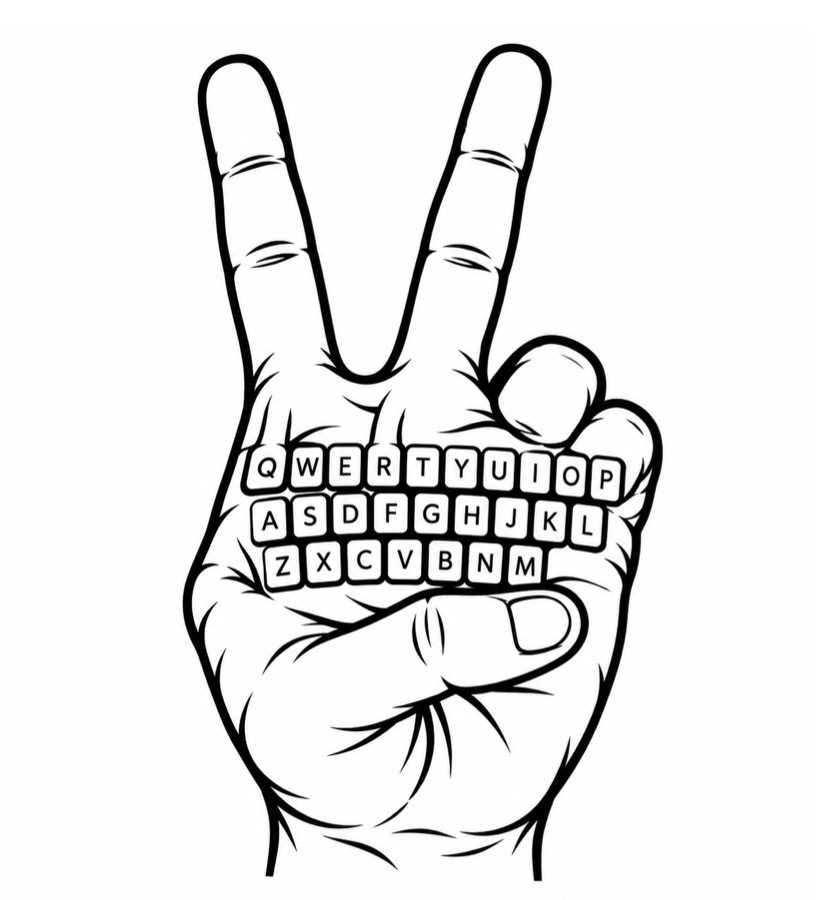

# Démarche créative : nom et logo

La première exploration documentée est datée du **29 septembre 2026** dans l’export de la conversation sur le concept de clavier. Le brief du **1er octobre 2026** présente le nom et le logo Guépard. Le **20 novembre 2026** est la date de documentation et de vérification du nom.

Ce document retrace les choix du nom et du logo pour les exigences DES-01 et DES-02 de la [matrice d’exigences](EXIGENCES.md).

## 1. Les premières pistes : main, clavier et jeu pour enfants

Mon premier concept est un dessin noir et blanc d’une main avec un clavier dans la paume. Je précise que l’index et le majeur forment un signe de paix et se posent sur les touches Q et R. L’idée est de représenter une application de vitesse de frappe. ChatGPT en produit des propositions visuelles à partir de ma description, que je corrige pour obtenir une seule main plutôt que deux.

Je cherche ensuite des références de sites pour enfants, ludiques, animés et très visuels. ChatGPT propose notamment My Little Storybook, Nike PLAYlab, Pribináček et London Express : ce sont les références citées dans l’échange, sans nouvelle vérification de ces sites ici. L’univers évolue vers la jungle et les animaux rapides, puis vers une palette sable, verts, orange, jaune et bleu. Voir la [direction artistique](design/direction-artistique.md) et le [moodboard](design/moodboard.md).

## 2. Le nom : des jeux de mots à Guépard

**Recherche initiale, le 29 septembre 2026 selon l’export.** Je demande un nom évoquant la vitesse et la compétition, dans l’esprit de « GOAT » ou de « race ». ChatGPT propose : **KeyRush, GOAT Keys, QWERTY Rush, KeyRivals, Clack Race, FingerDash, KeySprint, RushRank, Clack Club et Qlash**. Ces propositions viennent de l’outil ; elles ne constituent pas toutes une sélection personnelle.

**Recherche autour de QWERTY, puis des animaux.** Dans la conversation de conception Guépard, je demande d’abord un jeu de mots avec QWERTY et race. Je rejette ensuite cette piste et demande de partir des animaux les plus rapides, en proposant moi-même le guépard. Je demande aussi de retirer QWERTY du nom. ChatGPT explore alors des noms construits autour du clavier et du guépard.

| Piste | Noms retrouvés | Suite donnée dans les échanges |
|---|---|---|
| Vitesse et compétition | KeyRush, GOAT Keys, QWERTY Rush, KeyRivals, Clack Race, FingerDash, KeySprint, RushRank, Clack Club, Qlash | Première exploration proposée par ChatGPT, avant la piste animale |
| QWERTY et course | QWERTY Race, QWERTY Rush, QWERTY Racer, QWERTY Dash, QWERTY Sprint, QWERTY Prix, QWERTY, SET, GO! | Piste explicitement écartée ; je demande un lien avec les animaux rapides, puis le retrait de QWERTY |
| Guépard, touches et frappe | Keytah, Cheetap, Typard, Cheetkey, KeySprint, Spotype, Cheetype, Keypard, Tapard, SpotKey, PawType, TapSprint, TypeSprint | Propositions de ChatGPT ; CHEETAP fait aussi l’objet d’un essai visuel avec une patte et des touches |
| Guépard Type | Variante citée dans mon explication rétrospective | Non retenue ; elle explicite la frappe mais allonge le nom et mélange français et anglais |
| **Guépard** | Choix que j’exprime dans la conversation | **Retenu** : court, en français, facile à retenir et directement lié à la vitesse |

Le choix final vient de moi : après avoir demandé de retirer QWERTY, j’exprime mon choix du nom Guépard. Le guépard représente la rapidité ; le clavier du logo explique la frappe. L’aide de ChatGPT dans la recherche des variantes est donc documentée.

**Vérification d’originalité.**

Recherche documentaire effectuée le **20 novembre 2026**, lors de la rédaction de ce document, avec les requêtes « Guépard jeu de frappe », « Guepard typing game », « Guépard dactylographie » et `site:github.com "guepard" "typing game"`.

Aucun jeu portant exactement le nom **Guépard** n'a été identifié dans les résultats consultés. En revanche, le rapprochement entre guépard et vitesse de frappe existe déjà : [Animal Typing - Lite](https://play.google.com/store/apps/details?hl=fr&id=com.coq.animaltyping.lite), de Corentin Faucher, utilise cet animal comme récompense de rapidité et de précision. Le nom Guepard est également employé sur GitHub par [Guepard-Corp/gfs](https://github.com/Guepard-Corp/gfs), un projet de gestion de versions de bases de données, sans rapport avec la dactylographie.

Cette recherche limitée ne démontre donc pas l'unicité du nom ni du concept. Les registres de marques et la disponibilité des noms de domaine n'ont pas été vérifiés.

## 3. Du concept de clavier au logo final

**Première exploration visuelle.** L’image ci-dessous est extraite de la page 3 de `Conversation_concept_clavier.pdf`. Elle illustre mon idée de main et de clavier, générée par ChatGPT. La date du **29 septembre 2026** est celle indiquée par l’export pour ces échanges ; ce n’est pas la date attestée d’un dessin manuel.



**Le croquis personnel.** Dans mon explication rétrospective, je décris un croquis de clavier à partir duquel j’imagine le guépard endormi. Les deux exports ne contiennent pas de photo identifiée de ce croquis personnel, ni sa date. La référence de tigre visible à la page 5 de la conversation Guépard est une référence de style ; le dessin de guépard noir et blanc de la page 4 est une étape de la génération.

<!-- À COMPLÉTER : ajouter la photo du croquis personnel du clavier et sa date si cette pièce est retrouvée. L’image exploratoire ci-dessus est générée, pas dessinée à la main par l’autrice. -->

**Réalisation avec l’aide de l’IA.** La conversation de conception montre les étapes suivantes :

1. Un essai **CHEETAP** associe une patte de guépard à des touches de clavier (annexe, page 8).
2. Pour **Guépard**, je demande à ChatGPT de générer un guépard endormi sur un clavier. Une première proposition est une mascotte 3D avec le nom écrit sous l’image (page 3).
3. Je demande un animal dessiné plus réaliste, vu de dessus, avec un clavier dont on voit les touches. Une version noir et blanc est présentée (pages 3 et 4).
4. Je demande de retirer le nom écrit, de coucher l’animal sur certaines touches et d’obtenir un rendu papier/crayon, en fournissant une référence graphique de tigre (page 5).
5. Je demande une **coloration au feutre** et le retrait du fond. La proposition colorée apparaît page 6. L’export indique encore qu’une vraie version transparente peut être une étape suivante : il ne prouve pas que cette demande a été entièrement réalisée à ce stade.
6. Le logo est fourni à l’agent du site le **1er octobre 2026**. Le commit `24333c3`, enregistré le **2 octobre 2026 à 14 h 14** (heure de Toronto), contient le logo et son utilisation dans l’en-tête. Le fichier du site est une copie du fichier fourni `guepard.png`. Cette date correspond à l’enregistrement Git de cette version.

L’idée, le choix du nom et les demandes de modification viennent de moi ; **ChatGPT a aidé à chercher les noms et à générer les propositions de logo**. Le rendu papier/crayon/feutre est une apparence demandée à l’outil : le logo final n’est pas présenté comme un dessin entièrement réalisé à la main. L’export ne précise pas le modèle de génération d’images utilisé.

**Symbolique.** Le guépard représente la vitesse ; le clavier représente la frappe. Le sommeil apporte de l’humour et un ton accueillant : l’animal le plus rapide se repose en attendant la prochaine course.

Le [logo final intégré au site](../public/assets/guepard-logo.png) conserve cette association.

## 4. Chronologie documentée

| Date précise | Événement | Source |
|---|---|---|
| **29 septembre 2026** | Exploration du concept main-clavier et premières propositions de noms | Date indiquée page 1 de `Conversation_concept_clavier.pdf` |
| **1er octobre 2026 à 19 h 46** | Brief du site présentant le nom Guépard, le thème jungle et le logo fourni | Conversation locale ; heure de Toronto |
| **1er octobre 2026 à 20 h 02** | Demande d’utiliser le logo fourni | Conversation locale ; heure de Toronto |
| **2 octobre 2026 à 14 h 14** | Enregistrement d’une version du site contenant le logo dans l’en-tête | Commit `24333c3` ; heure de Toronto |

Les recherches QWERTY et CHEETAP, le choix de Guépard, les variantes du logo et la palette sont présentés dans l’export de conception sans date par message. Leur déroulement est décrit dans les sections précédentes ; aucune date précise ne leur est attribuée. La date du croquis personnel n’est pas renseignée.

**Documentation : 20 novembre 2026.** Réception des exports et vérification documentaire du nom. Cette date ne correspond pas à la conception.

## 5. Sources de la reconstitution

- `Conversation_concept_clavier.pdf`, 3 pages : date du 29 septembre indiquée page 1 ; concepts générés pages 1 et 3 ; tableau des noms page 2. Certaines parties sont des images : elles ont été lues visuellement en plus de l’extraction de texte.
- `conversation_projet_guepard.pdf`, 8 pages : références et noms page 2 ; variantes du logo pages 3 à 6 ; palette page 7 ; essai CHEETAP page 8. Cet export de conception ne fournit pas de dates par message.
- Les [échanges partagés sur les sites pour enfants](https://chatgpt.com/share/6b0089e5-6df8-83ea-ac4b-9bd67d782cca) et les [noms liés au clavier et à la vitesse](https://chatgpt.com/share/6b008a18-83a8-83ea-885d-7a81711af8f3) ont été communiqués par l’autrice ; la lecture a été effectuée sur ses exports PDF, les pages partagées n’étant pas lisibles par l’outil.
- Conversation locale du 1er octobre 2026 et premier commit `24333c3` du 2 octobre 2026.
- Explication personnelle rétrospective du 20 novembre 2026 sur Guépard Type et le croquis du clavier.
- Recherche documentaire du 20 novembre 2026 : sources liées dans la section sur l’originalité.

## 6. Régénérer le PDF

La source HTML et le script Playwright sont archivés ci-dessous pour conserver le style sans dépendre du dossier temporaire. Extraire le contenu entre `SOURCE_HTML` et `FIN_SOURCE_HTML` dans `demarche.html`, et entre `SCRIPT_RENDU` et `FIN_SCRIPT_RENDU` dans `render.mjs`, puis lancer :

```sh
CHROME_EXE='/Applications/Google Chrome.app/Contents/MacOS/Google Chrome' node render.mjs "$PWD/demarche.html" "$PWD/demarche.pdf" "$PWD/preview.png"
```

Les chemins des images, des polices et de Playwright correspondent à l’emplacement local du projet ; les adapter si celui-ci est déplacé.

<!-- ARCHIVE_REGENERATION
SOURCE_HTML
<!doctype html><html lang="fr"><head><meta charset="utf-8"><title>Guépard - Démarche créative</title><style>
@font-face{font-family:'DM Sans';font-weight:400;src:url(file:///Users/marissabellebindeki/Downloads/Guepard/public/fonts/dm-sans-400-latin.woff2) format('woff2')}
@font-face{font-family:'DM Sans';font-weight:400;src:url(file:///Users/marissabellebindeki/Downloads/Guepard/public/fonts/dm-sans-400-latin-ext.woff2) format('woff2');unicode-range:U+0100-024F}
@font-face{font-family:'Nunito';font-weight:700;src:url(file:///Users/marissabellebindeki/Downloads/Guepard/public/fonts/nunito-700-latin.woff2) format('woff2')}
@font-face{font-family:'Nunito';font-weight:700;src:url(file:///Users/marissabellebindeki/Downloads/Guepard/public/fonts/nunito-700-latin-ext.woff2) format('woff2');unicode-range:U+0100-024F}
@font-face{font-family:'Kalam';font-weight:400;src:url(file:///Users/marissabellebindeki/Downloads/Guepard/public/fonts/kalam-400-latin.woff2) format('woff2')}
@font-face{font-family:'Kalam';font-weight:700;src:url(file:///Users/marissabellebindeki/Downloads/Guepard/public/fonts/kalam-700-latin.woff2) format('woff2')}

@page{size:Letter;margin:0}
*{box-sizing:border-box}html,body{margin:0}
body{font-family:'DM Sans',Arial,sans-serif;font-size:10pt;line-height:1.45;color:#26362d;background:#fff;-webkit-print-color-adjust:exact;print-color-adjust:exact}
.page{width:8.5in;height:11in;padding:.58in .7in .65in;position:relative;break-after:page;overflow:hidden;background:#fff}
.page:last-child{break-after:auto}
.running{display:flex;justify-content:space-between;padding-bottom:.10in;border-bottom:2px solid #2f6b3d;font-size:8pt;letter-spacing:.08em;text-transform:uppercase;color:#41624b}
.title{display:grid;grid-template-columns:1fr 1.25in;gap:.3in;align-items:center;margin:.24in 0 .20in}
h1{font-family:'DM Sans',Arial,sans-serif;font-weight:400;font-size:25pt;line-height:1.12;color:#23482f;margin:0 0 .12in;letter-spacing:-.025em}
h2{font-family:'DM Sans',Arial,sans-serif;font-size:12pt;font-weight:400;color:#23482f;border-bottom:1px solid #d4dfd2;margin:.18in 0 .08in;padding-bottom:.04in}
p{margin:.06in 0}strong{font-weight:600;color:#23482f}.subtitle{font-size:10.3pt;color:#5a685e}.title img{width:1.25in}
section{break-inside:avoid}table{width:100%;border-collapse:collapse;font-size:9pt;line-height:1.4;margin:.09in 0}
th{text-align:left;background:#edf3e9;color:#23482f;font-weight:600;padding:.08in .1in;border-top:1px solid #bed0b7;border-bottom:1px solid #bed0b7}
td{padding:.075in .1in;vertical-align:top;border-bottom:1px solid #dfe5dc}
td:first-child{width:31%}.small{font-size:8.5pt;line-height:1.4;color:#5a685e}a{color:#2f6b3d;text-decoration:underline;text-underline-offset:2px}
footer{position:absolute;bottom:.34in;left:.7in;right:.7in;display:flex;justify-content:space-between;border-top:1px solid #cbd7c7;padding-top:.08in;color:#607164;font-size:8pt}
.figures{display:grid;grid-template-columns:1fr 1fr;gap:.3in;margin:.14in 0 .12in}
figure{margin:0;display:grid;grid-template-columns:1in 1fr;align-items:center;gap:.13in;padding:.10in 0;border-bottom:1px solid #dfe5dc}
figure img{width:1in;height:.96in;object-fit:contain}figcaption{font-size:8.4pt;line-height:1.4;color:#5a685e}
ol{margin:.08in 0;padding-left:.19in}li{margin:.035in 0;padding-left:.035in}.note{border-left:2px solid #8da983;padding:.03in 0 .03in .12in;margin:.11in 0}
</style></head><body><div class="page"><div class="running"><span>GUÉPARD</span><span>Conception du nom et du logo</span></div><header class="title"><div><h1>Démarche créative<br>Nom et logo</h1><p class="subtitle">Origine du concept, recherche du nom et développement de l’identité visuelle.</p></div></header>
<section><h2>1. Origine du concept</h2><p>Le <strong>29 septembre 2026</strong>, je décris un clavier dans la paume d’une main, avec l’index et le majeur en signe de paix sur les touches Q et R. ChatGPT produit une première interprétation en noir et blanc ; je précise ensuite qu’il s’agit d’une seule main.</p><p>La recherche se poursuit par des références de sites pour enfants, puis par un univers associant animaux rapides et jungle. La palette retenue comprend le beige sable, les verts, l’orange, le jaune et le bleu. L’objectif est une interface ludique, lisible et accueillante.</p></section>
<section><h2>2. Recherche et choix du nom</h2><p>Les pistes sont explorées avec ChatGPT. Je rejette les noms construits autour de QWERTY et propose le guépard comme symbole de rapidité. Je choisis finalement le nom <strong>Guépard</strong>.</p>
<table><thead><tr><th>Piste et exemples</th><th>Décision et justification</th></tr></thead><tbody>
<tr><td>KeyRush, GOAT Keys, Qlash, KeyRivals, Clack Race</td><td>Premières propositions autour de la vitesse et de la compétition ; exploration remplacée par la piste animale.</td></tr>
<tr><td>QWERTY Race, QWERTY Rush, QWERTY Dash</td><td>Piste écartée. Je demande un lien avec les animaux rapides, puis le retrait de QWERTY.</td></tr>
<tr><td>CHEETAP, Keytah, Typard, Cheetype, Keypard</td><td>Jeux de mots liés au guépard et à la frappe. Un essai visuel CHEETAP associe une patte à des touches.</td></tr>
<tr><td>Guépard Type</td><td>Variante non retenue : plus longue et composée de français et d’anglais.</td></tr>
<tr><td><strong>Guépard</strong></td><td><strong>Nom retenu.</strong> Court, en français et facile à mémoriser. L’animal évoque la vitesse ; le clavier du logo précise l’activité.</td></tr></tbody></table><p class="small">La liste complète des propositions figure dans le document Markdown. Les suggestions de l’outil sont distinguées du choix personnel.</p></section>
<section><h2>3. Vérification d’originalité</h2><p>Une recherche documentaire est effectuée le <strong>20 novembre 2026</strong> avec les termes « Guépard jeu de frappe », « Guepard typing game » et « Guépard dactylographie », ainsi qu’une recherche ciblant GitHub.</p><p>Aucun jeu nommé exactement Guépard n’est identifié dans les résultats consultés. <a href="https://play.google.com/store/apps/details?hl=fr&amp;id=com.coq.animaltyping.lite">Animal Typing - Lite</a> utilise toutefois déjà le guépard comme récompense de rapidité et de précision. <a href="https://github.com/Guepard-Corp/gfs">Guepard-Corp/gfs</a> emploie également ce nom dans un autre domaine.</p><p class="small">Cette recherche ne démontre ni l’unicité du nom ni celle du concept. Les registres de marques et les noms de domaine n’ont pas été vérifiés.</p></section><footer><span>GUÉPARD · Démarche créative</span><span>1 / 2</span></footer></div><div class="page"><div class="running"><span>GUÉPARD</span><span>Conception du nom et du logo</span></div><section><h2>4. Développement du logo</h2><div class="figures"><figure><figcaption><strong>Concept initial</strong><br>Main et clavier, généré par ChatGPT à partir de ma description.<br>29 septembre 2026, selon l’export.</figcaption></figure><figure><figcaption><strong>Logo retenu</strong><br>Guépard endormi sur un clavier, avec un rendu illustré au feutre.</figcaption></figure></div>
<p>La conversation de conception retrace cinq étapes :</p>
<ol><li>Exploration CHEETAP : une patte de guépard associée à des touches.</li><li>Demande de génération d’un guépard endormi sur un clavier ; première proposition en 3D avec le nom écrit.</li><li>Demande d’un animal dessiné plus réaliste, d’une vue de dessus et d’un clavier lisible ; proposition noir et blanc.</li><li>Retrait du nom écrit, position de l’animal sur certaines touches et rendu papier/crayon, avec une référence graphique de tigre.</li><li>Demande de coloration au feutre et de retrait du fond. L’export présente la version colorée ; il ne confirme pas l’obtention d’un fond transparent à cette étape.</li></ol>
<p><strong>Contribution personnelle :</strong> concept, choix du nom, références et demandes de modification. <strong>Contribution de ChatGPT :</strong> recherche de variantes et génération des propositions de logo. L’aspect dessiné ne correspond pas à une réalisation entièrement manuelle.</p><p>Le guépard représente la rapidité, le clavier la frappe et le sommeil apporte une touche d’humour à l’identité du jeu.</p>
<p class="note small"><strong>Croquis personnel.</strong> Un croquis de clavier est évoqué dans mon explication. Sa photo et sa date ne figurent pas dans les exports fournis. Le concept généré et la référence de tigre ne constituent pas cette pièce personnelle.</p></section>
<section><h2>5. Chronologie documentée</h2><table><thead><tr><th>Date</th><th>Événement attesté</th></tr></thead><tbody>
<tr><td>29 septembre 2026</td><td>Exploration main-clavier et premières propositions de noms. Date indiquée dans l’export de la conversation.</td></tr>
<tr><td>1er octobre 2026<br>19 h 46</td><td>Brief du site présentant le nom Guépard, le thème jungle et le logo fourni.</td></tr>
<tr><td>1er octobre 2026<br>20 h 02</td><td>Demande d’utiliser le logo fourni.</td></tr>
<tr><td>2 octobre 2026<br>14 h 14</td><td>Enregistrement du commit 24333c3 contenant le logo et son utilisation dans l’en-tête.</td></tr></tbody></table><p class="small">Heures de Toronto. L’export de conception ne date pas individuellement les recherches de noms et les variantes du logo ; aucune date précise ne leur est attribuée. La date du croquis personnel n’est pas renseignée.</p></section>
<section><p class="small"><strong>Sources.</strong> Conversation_concept_clavier.pdf, p. 1 à 3 ; conversation_projet_guepard.pdf, p. 2 à 8 ; conversation locale du 1er octobre 2026 ; historique Git (24333c3). Vérification documentaire : 20 novembre 2026.</p></section><footer><span>GUÉPARD · Démarche créative</span><span>2 / 2</span></footer></div></body></html>
FIN_SOURCE_HTML
SCRIPT_RENDU
import {chromium} from '/Users/marissabellebindeki/Downloads/Guepard/node_modules/@playwright/test/index.mjs';
const [html,pdf,png]=process.argv.slice(2);
const b=await chromium.launch({executablePath:process.env.CHROME_EXE,args:['--allow-file-access-from-files']});
const p=await b.newPage({viewport:{width:816,height:1056}});
await p.goto('file://'+html,{waitUntil:'networkidle'});await p.evaluate(()=>document.fonts.ready);
await p.pdf({path:pdf,format:'Letter',printBackground:true,preferCSSPageSize:true});
await p.screenshot({path:png,fullPage:true});
console.log('pages:',await p.evaluate(()=>document.querySelectorAll('.page').length),'height',await p.evaluate(()=>document.body.scrollHeight));
await b.close();

FIN_SCRIPT_RENDU
ARCHIVE_REGENERATION -->
