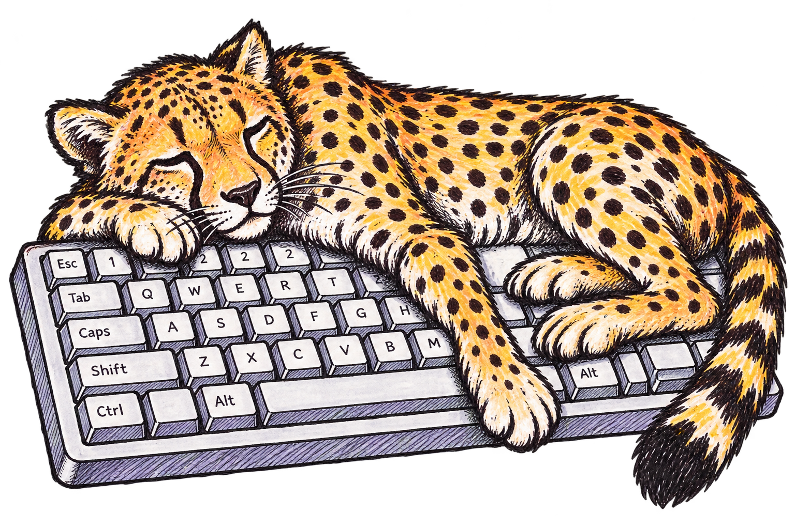
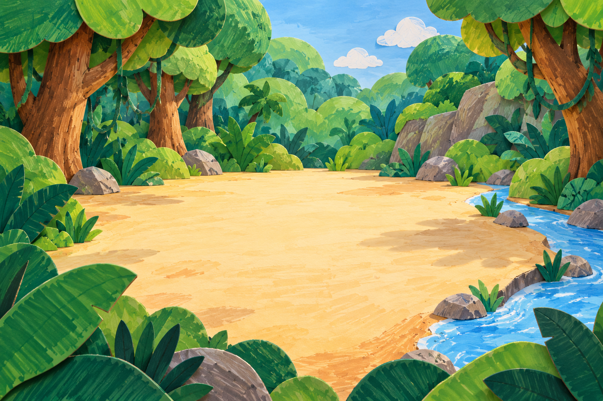
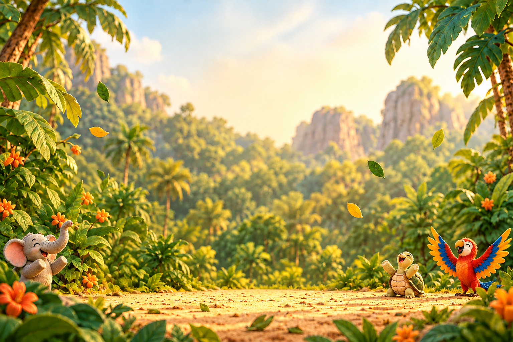

# Démarche créative : nom et logo

Ce document retrace le choix du nom et du logo (exigences DES-01 et DES-02) et présente la direction artistique (DES-03) de la [matrice d’exigences](EXIGENCES.md).

## 1. Le nom : Guépard

**Ma démarche.** J'ai d'abord choisi le thème de la **jungle**. J'ai ensuite cherché les animaux les plus rapides : le **lièvre**, le **lapin** et le **guépard**. J'ai choisi le guépard tout de suite, parce que c'est le plus rapide.

Mon premier nom était **Guépard Type**, que j'ai dessiné à la main **fin septembre 2026**. Je voulais quelque chose de plus original : j'ai raccourci en **Guépard**. Ce nom fait penser à la jungle et aux animaux, et il va mieux avec mon thème.

**Noms envisagés.**

| Nom ou piste | Retenu ? | Raison |
|---|---|---|
| Lièvre, lapin | Non | Animaux rapides, mais moins rapides que le guépard |
| Guépard Type | Non | Premier nom ; je voulais quelque chose de plus original et de plus court |
| **Guépard** | **Oui** | Court, en français, lié à la vitesse, à la jungle et aux animaux |

**Vérification d’originalité.** Recherche effectuée le **20 novembre 2026** avec les requêtes « Guépard jeu de frappe », « Guepard typing game », « Guépard dactylographie » et `site:github.com "guepard" "typing game"`.

Aucun jeu portant exactement le nom **Guépard** n'a été trouvé dans les résultats consultés. Le rapprochement entre guépard et vitesse de frappe existe déjà : [Animal Typing - Lite](https://play.google.com/store/apps/details?hl=fr&id=com.coq.animaltyping.lite) utilise cet animal comme récompense de rapidité. Le nom Guepard est aussi employé sur GitHub par [Guepard-Corp/gfs](https://github.com/Guepard-Corp/gfs), un projet de bases de données sans rapport avec la dactylographie. Les registres de marques et les noms de domaine n'ont pas été vérifiés.

## 2. Le logo : un guépard couché sur un clavier

**Mon idée et mon croquis.** Mon idée de base pour Guépard était un **guépard qui se couche sur un clavier**. Je l'ai dessinée à la main dans mon carnet **fin septembre 2026** : le « tableau du clavier » et le guépard allongé dessus.

**Du croquis au logo final.** Pour faire ressortir l'image à partir de ce croquis, j'ai utilisé ChatGPT. Le logo final est intégré dans l'en-tête du site et sert de favicon.

**Symbolique.** Le guépard représente la vitesse, et le clavier représente la frappe. Le sommeil ajoute de l'humour et un ton accueillant : l'animal le plus rapide se repose en attendant la prochaine course.

## 3. Direction artistique : moodboard, palette et typographies

Le détail est dans la [direction artistique](design/direction-artistique.md) et le [moodboard](design/moodboard.md).

**Moodboard (4 références).** Une clairière illustrée, des animaux expressifs en relief 3D mat avec des traces de feutre, et un centre assez calme pour accueillir l'action de jeu.

| Jungle et espace de jeu | Identité |
| --- | --- |
|  |  |

| Personnages | Ambiance des résultats |
| --- | --- |
|  |  |

**Palette.**

| Couleur | Code | Usage |
| --- | --- | --- |
| Beige sable | `#F7E7C6` | Papier, lumière, zones calmes |
| Vert feuille | `#5BAE4A` | Feuilles, états positifs, touches secondaires |
| Vert forêt | `#2F6B3D` | En-tête, pied de page, titres et contraste |
| Orange mangue | `#F28C28` | Action principale et moments de départ |
| Jaune soleil | `#F6C445` | Accents, chaleur et mise en valeur |
| Bleu rivière | `#5BC0EB` | Eau, détails et respiration dans la palette |

**Typographies.** **Nunito** pour les titres et le nom, **DM Sans** pour l'interface et les textes, **Kalam** pour quelques accents manuscrits.

**Mots-clés.** Accueillant, ludique, artisanal, clair, vivant, collectif.

## 4. Chronologie

| Date | Étape |
|---|---|
| **Fin septembre 2026** | Choix du thème jungle, recherche des animaux les plus rapides, nom « Guépard Type » puis « Guépard » ; croquis à la main du nom et du guépard couché sur le clavier |
| **1er octobre 2026** | Logo final prêt à partir du croquis |
| **2 octobre 2026** | Premier commit du site, avec le logo dans l'en-tête (`24333c3`) |
| **7 octobre 2026** | Direction artistique et moodboard mis en forme dans le dépôt |
| **20 novembre 2026** | Vérification d'originalité du nom et ajout des photos des croquis |

La version PDF ([DEMARCHE-CREATIVE.pdf](DEMARCHE-CREATIVE.pdf)) est générée à partir de ce fichier.
