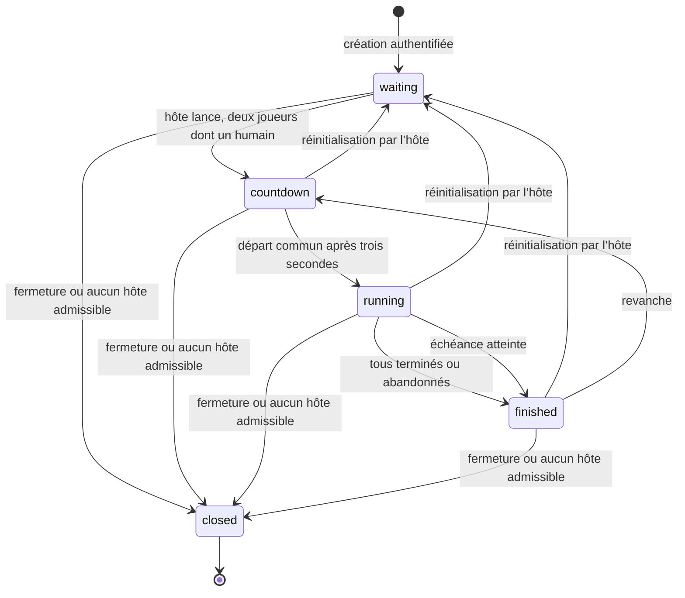

# Machine à états du salon

Les transitions courantes et les règles de sécurité sont détaillées dans [l’architecture](../ARCHITECTURE.md). La fermeture supprime le salon ; `closed` est un état conceptuel.

Une nouvelle entrée est refusée pendant le décompte et la course. Un membre existant peut se reconnecter ; après trente secondes sans présence réseau, le serveur enregistre son abandon. L’absence de frappe seule ne constitue pas une déconnexion. Le départ de l’hôte transfère son rôle au plus ancien humain authentifié admissible ; la fermeture est une action distincte.

Les bots suivent une grille temporelle serveur déterministe. Les bonus, la limite de durée et les heures individuelles de fin ou d’abandon sont calculés côté serveur. Un seul concurrent actif peut continuer jusqu’à son arrivée, son abandon ou l’échéance.
