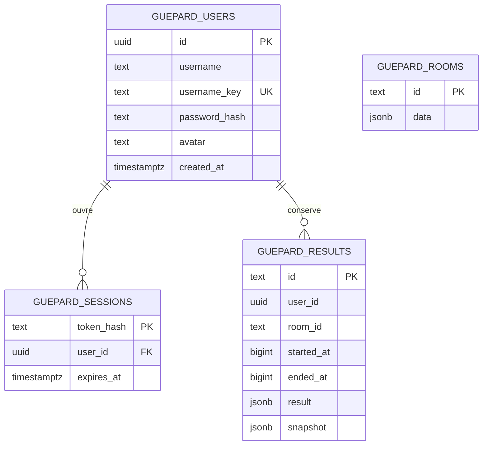
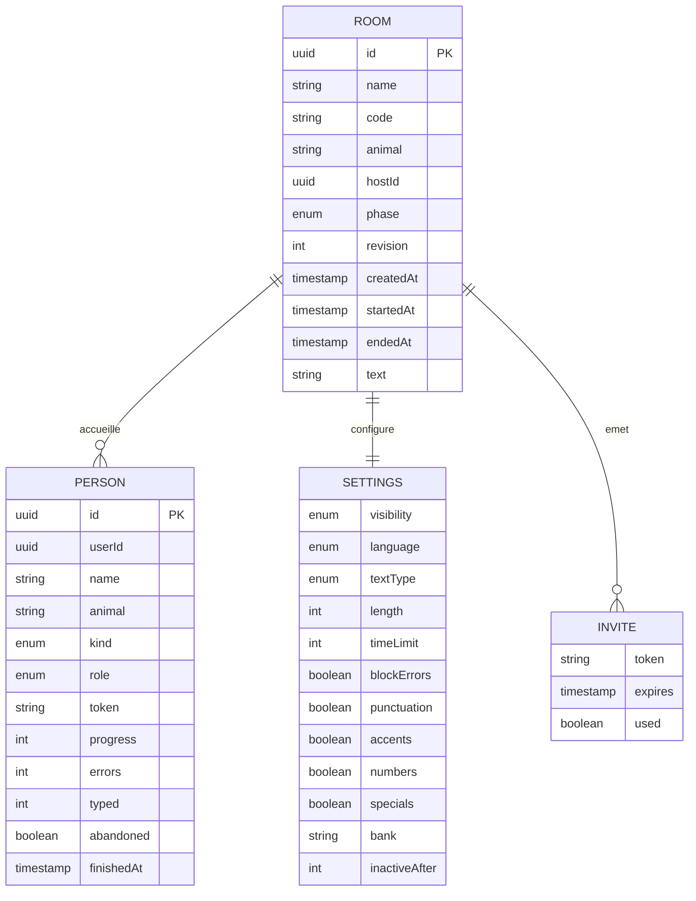

# GUÉPARD - Schéma de données

**État au 12 novembre 2026.** Le schéma sépare ce qui est physiquement dans PostgreSQL de la structure logique des salons conservée en JSONB. Il décrit l'implémentation actuelle ; Les résultats des comptes sont conservés côté serveur ; les invités et la heatmap restent en session navigateur.

## Tables PostgreSQL

`username_key` garantit l'unicité du pseudo sans tenir compte de la casse. `password_hash` contient un hachage scrypt salé. La session utilise un jeton aléatoire envoyé en cookie `HttpOnly` ; seul son hachage est enregistré dans la table. Une session expire après 30 jours. Les tables sont créées au premier accès par le serveur Next.js.

## Contenu logique de `guepard_rooms.data`

`ROOM`, `PERSON`, `SETTINGS` et `INVITE` sont des objets imbriqués dans le JSONB, **pas des tables distinctes**. La relation entre un compte et une personne du salon n’est pas une clé étrangère : le serveur reprend `userId`, le pseudo et l’animal du compte lors de l’entrée, puis le salon garde un instantané de ce participant. `userId` reste interne au serveur et est retiré des vues partagées. Un invité n'a pas besoin de compte. Les spectateurs restent dans `people`, mais ne comptent pas comme concurrents.

## Vie des données et permissions

- Le serveur retire `token` et `userId` des participants et `invites` avant d'envoyer un salon au navigateur. Seule la personne courante reçoit sa saisie `input` pour reprendre après reconnexion.
- Le jeton de membre du salon est distinct du cookie de compte. Il est conservé dans `sessionStorage` par navigateur et vérifié pour lire ou modifier le salon.
- Les paramètres, membres et progrès vivent dans le salon PostgreSQL. Les résultats des humains connectés sont enregistrés dans `guepard_results` à la transition vers les résultats, dans la même transaction. La contrainte `UNIQUE(user_id, room_id, started_at)` empêche les doublons. Le lien vers le compte est logique, sans clé étrangère SQL pour cette table. Le snapshot nettoyé ne contient ni jetons, ni identifiants de compte, ni saisies, ni code d’accès ; il reste consultable après suppression du salon. La heatmap et les résultats invités restent locaux à la session.
- Sans `DATABASE_URL`, le mode de secours de développement utilise `.data/rooms.json`. Il n'est pas destiné à plusieurs instances serveur.

La lecture de l’historique et de ses snapshots filtre systématiquement par l’identifiant du compte authentifié. Les séries temporelles intra-course ne sont pas encore collectées.

Sources de vérité : [`result-store.ts`](../../src/server/result-store.ts), [`room-types.ts`](../../src/lib/room-types.ts), [`auth-store.ts`](../../src/server/auth-store.ts), [`room-store.ts`](../../src/server/room-store.ts), [`room-engine.ts`](../../src/server/room-engine.ts).
